# AI Job Sleep Manager

[English](README.md) | [한국어](README.ko.md) | **日本語**

**AIによる開発作業の実行中はWindows PCの自動スリープを防ぎ、作業が終わったら指定時間後にスリープまたは通常のシャットダウンを要求するアプリです。**

CodexやClaude Codeに時間のかかる作業を任せて離席する開発者向けです。AIアプリのウィンドウが開いているかではなく、観測できたジョブの状態を基準に電源を管理します。

> **開発状況：初期実装・実環境での検証中。** 自動テストの全件が成功しています。Windowsアプリのビルドと観察モードでの起動は確認済みです。実際のPCのスリープ・復帰・シャットダウン、および対象環境すべてでの無人運用は未検証です。

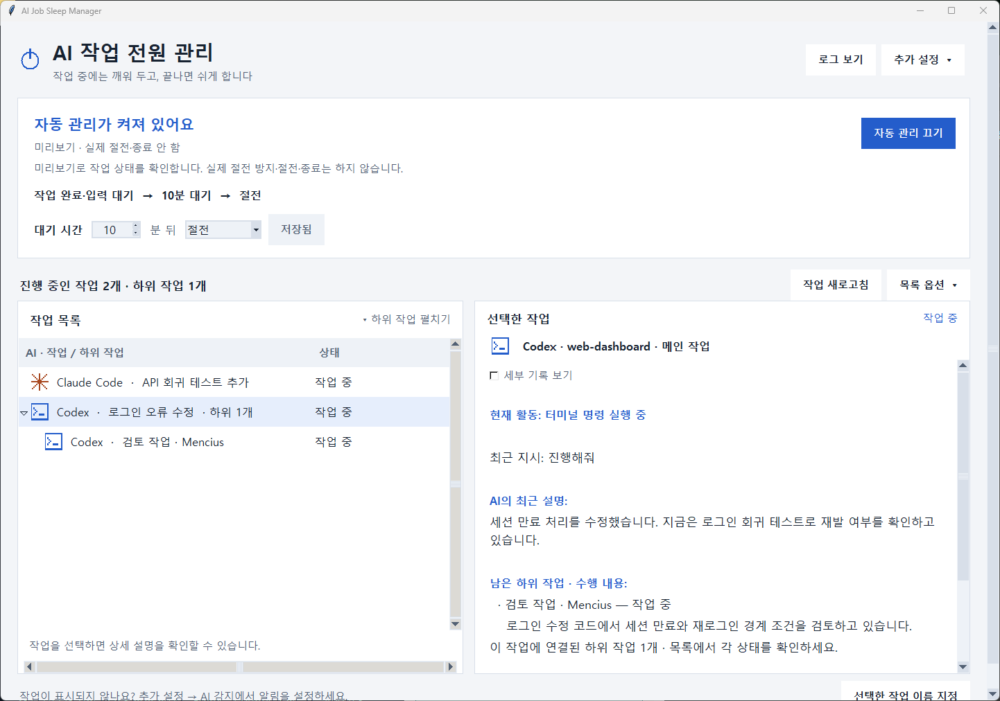

### シンプルな基本操作

- メイン画面の **대기 시간** で待ち時間とスリープ・通常終了を選び、**저장**（保存）を押します。保存だけでは自動管理は有効になりません。
- 同じパネルの **자동 관리 켜기 / 끄기**（自動管理をオン / オフ）で開始・停止します。管理状態、適用中の動作、実際の電源制御かプレビューかを確認できます。
- **추가 설정**（追加設定）で実行モード・AI検出・テーマ・自動起動を設定します。**목록 옵션**（一覧オプション）で完了・過去の作業を表示し、**세부 기록 보기**（詳細記録）で時刻・接続情報・セッションIDを確認できます。

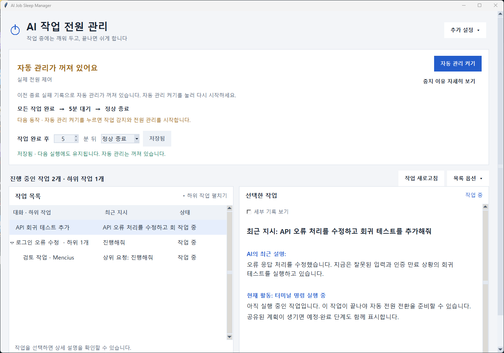


*スクリーンショットは実際の韓国語UIに独立したサンプルデータを読み込んだものです。個人の会話やPCの電源切り替え成功を示すものではありません。READMEの言語選択でアプリのUI言語は変わりません。*

## 目次

- [主な機能](#主な機能)
- [対象環境](#対象環境)
- [クイックスタート](#クイックスタート)
- [接続と設定](#接続と設定)
- [観察モードと実際の電源制御](#観察モードと実際の電源制御)
- [スリープとシャットダウンの条件](#スリープとシャットダウンの条件)
- [Windows再起動後の復旧](#windows再起動後の復旧)
- [ローカルデータとプライバシー](#ローカルデータとプライバシー)
- [トラブルシューティング](#トラブルシューティング)
- [開発と実行ファイルの作成](#開発と実行ファイルの作成)
- [検証状況と制限事項](#検証状況と制限事項)

## 主な機能

### 残っている作業を確認

各行にAIの**アイコンと名前**を常に表示します。Codexはターミナル、Claude Codeは星形です。選択した作業の上部にはAI名・プロジェクト・メイン/下位作業の区分も表示します。公式ロゴをダウンロードせず、アプリ独自の識別記号を使用しています。

表示情報は `sleep_manager/providers.py` にまとめています。未登録のAIは共通アイコンとIDで表示し、別のAI名には置き換えません。表示の登録だけでは新しいAIの作業検出は有効になりません。別途検出アダプターが必要です。

UUIDだけの自動タイトルは、取得できた最新指示に置き換えます。詳細では現在の活動を先に表示し、長い指示の強調を抑え、同じ作業の更新時もスクロール位置を保持します。

メイン作業と下位作業を分け、実行中・入力待ち・確認が必要・完了の件数を表示します。親の行を展開すると下位作業を確認でき、行を選ぶと最新の指示と公開された進捗説明が表示されます。完了した作業は初期状態では非表示ですが、チェックボックスで表示できます。

- **指示と活動の対応：** 会話のタイトル、最新の「続けて」といった指示、ファイルの読み取りやコマンド実行などの活動を区別します。
- **公開された説明と時刻：** 最新の公開応答、最後に観測した活動、短いツール実行履歴を表示します。古い記録には更新待ちと表示し、記録が増えないことを完了とは判断しません。
- **Codexの計画：** 対応する形式で明示的に共有された計画だけを表示します。進捗率や残り時間は推測しません。
- **下位作業：** 確認できたCodexの親IDで関連付けます。下位作業への直接の指示がない場合、確認済みの親の指示を別の項目として表示します。親の詳細から残っている下位作業の公開説明も確認できます。
- **指示の整理：** 添付ファイルの案内や既知の内部コンテキストを除外します。画像だけの投稿は画像添付として表示します。Codex内部のguardian承認評価セッションは、識別できたものに限って開発作業の件数から除外します。
- **作業名：** Codexのタイトルとプロジェクト名はローカル情報から取得します。`이름 지정`（名前を指定）で任意の名前を付けられます。Claudeはプロジェクト名と手動の名前に対応し、会話タイトルの自動取得には未対応です。

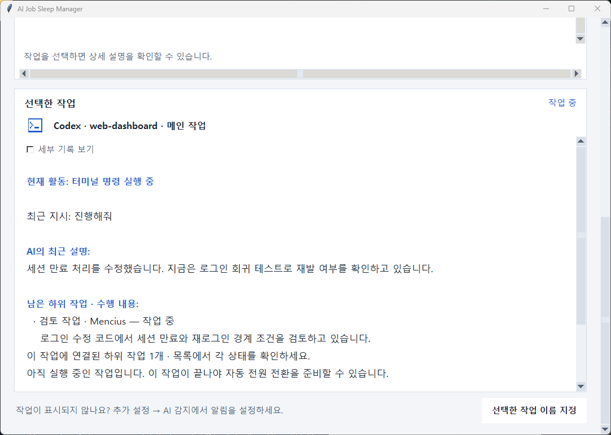

### 現在の接続と過去の未確認記録

起動時に復元した未終了の記録のうち、現在の接続を確認できないものは通常の作業一覧から分けて表示します。**목록 옵션 → 이전 실행 기록 보기**（過去の未確認・中断記録を表示）で確認できます。非表示の件数と、それらが自動電源切り替えを保留していることは常に表示します。

**작업 새로고침**（接続を再確認）は新しい状態イベントとClaudeのローカルセッション一覧を確認します。セッションID、PID、Windowsプロセスの作成時刻が一致した場合にだけ接続を認めます。古いPIDファイルや再利用されたPIDだけでは接続済みとしません。プロセスの接続は作業の実行中・完了の証拠ではありません。詳細に接続の根拠と最後の状態イベント時刻を表示します。新しいイベントを受けた記録は現在の一覧に戻ります。実行中の作業を古いという理由だけで隠すことはありません。

これは表示の分類であり、削除や自動完了ではありません。情報不足や権限エラーは未確認のままです。過去の記録でも終了を確認できなければ自動スリープ・終了は引き続き保留します。画面で隠しても電源切り替えは許可されません。元のAI画面で作業が終了したことを確認した場合は、対象を選んで手動で終了確認できます。

### Claude Codeの作業内容

hooksで既に検出したClaudeセッションのIDを、`.claude/projects/*/<session-id>.jsonl`のローカル記録に対応付けます。最新のユーザー指示、最新の公開応答、ファイルの読み取り・編集・検索・ターミナル実行などの活動を表示します。

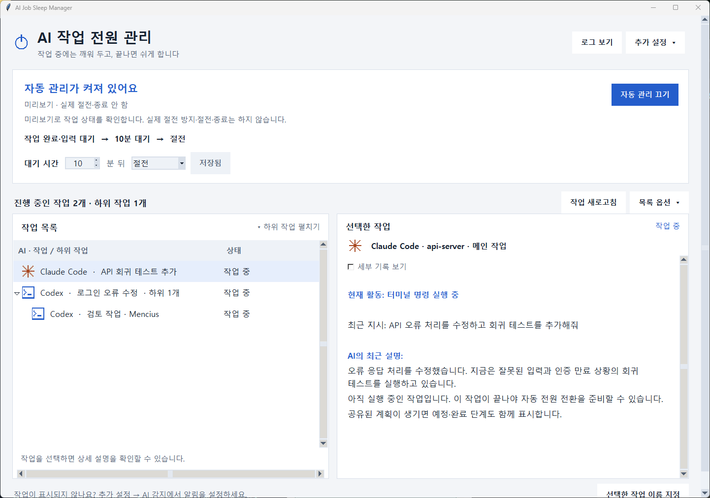

- ツールの結果、自動注入されたメタデータ、非公開のthinkingブロックをユーザー指示として表示しません。新しい指示を受けたら前の説明を消します。
- 過去の記録ファイルがあるだけでは実行中の作業を追加しません。Claudeの実行状態や完了は引き続きhooksで判断します。
- 対応する記録がない場合や読めない場合は未提供と表示します。1ファイルにつき末尾32MiB、1回の更新につき合計64MiBまで読みます。応答を表示するにはユーザー指示の境界を確認できる必要があります。
- 新しい指示のhookが記録より先に届いた場合は、前の指示を隠して更新を待ちます。hookと記録の時刻差は2秒まで許容します。
- 最新の公開応答は最終回答の場合もあります。応答の内容から実行中や完了を判定することはありません。
- Claudeの自動タイトル、詳細な計画、下位エージェントの記録本文には未対応です。リモートの記録は取得しません。

### 読みやすい表示と保存結果

文字サイズ、文字と背景のコントラスト、行の高さ、行間を調整しています。`추가 설정 → 화면·시작`（設定を開く → 表示・起動設定）で、テーマの`밝은 모드 / 다크 모드`（ライト / ダーク）と文字サイズの`기본 / 크게 / 아주 크게`（標準 / 大 / 特大）を選べます。選択は即時反映され、次回起動にも引き継がれます。一覧、入力欄、ドロップダウン、開いている診断画面にも適用されます。電源設定、作業状態、自動管理の状態、保存前の入力値は維持します。

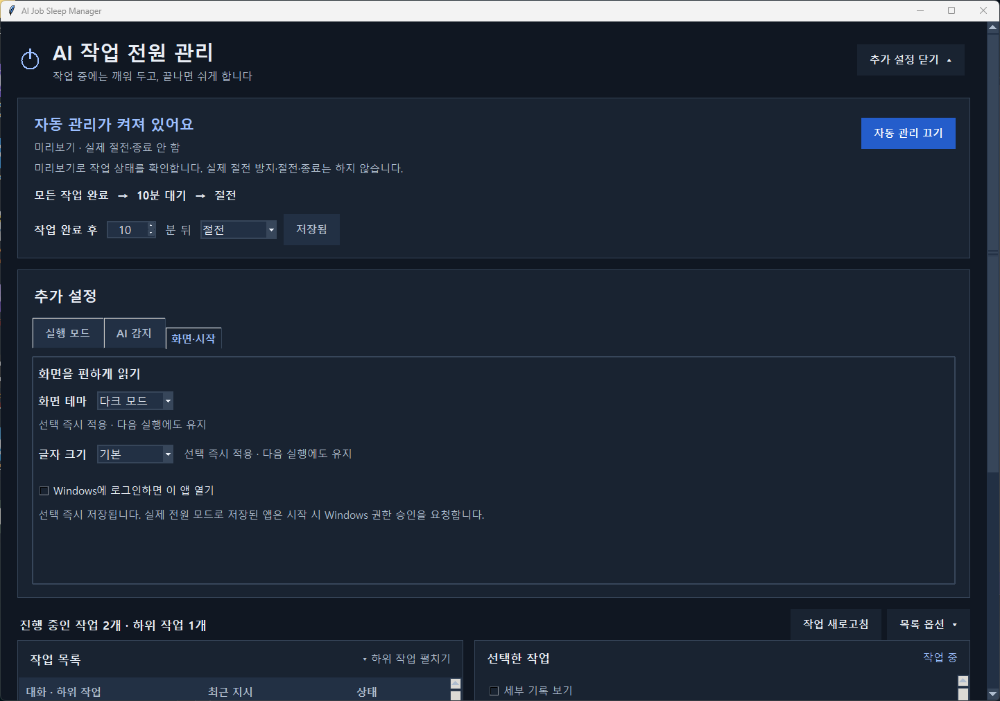

広いウィンドウでは一覧と詳細を左右に、狭いウィンドウでは上下に表示します。画面下の設定はページをスクロールして操作できます。長いタイトルは横スクロールや列幅の変更で確認できます。

`저장`（設定を保存）を押すと、ボタンの近くにチェックマーク、保存時刻、保存した値が表示されます。編集中の値は未保存と表示し、上部には適用中の設定を残します。保存に失敗した場合は以前の設定を維持します。時間や動作の保存だけでは実行モードは変わりません。

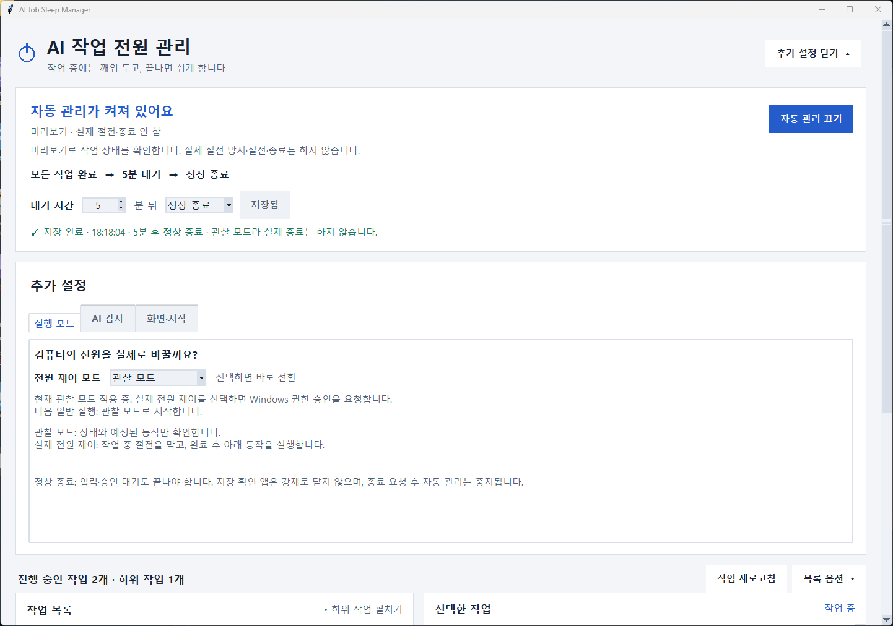

## 対象環境

対象は**Windows上でネイティブに実行するローカルのAI開発作業**です。

| 環境 | 連携方法 | 検証範囲 |
| --- | --- | --- |
| Codexデスクトップ | hooksとローカルの実行記録 | 実行中の検出を確認。完了・入力待ち・再開の全体検証は未完了 |
| Claudeデスクトップ内のClaude Code | Claude Code hooks、表示用のローカル記録 | デスクトップでの全体検証は未完了 |
| VS CodeターミナルのCodex CLI | hooksとローカルの実行記録 | 単独CLIのイベントを確認。正常完了の検証は未完了 |
| VS CodeターミナルのClaude Code | hooks、表示用のローカル記録 | hook受信と内容抽出を個別に確認。VS Code内の全体検証は未完了 |

通常のClaudeチャット、Cowork、ブラウザチャット、WSL、リモートマシンは自動接続の対象外です。アダプターの実装済みと、すべての動作を検証済みは異なります。このアプリはAI作業の実行、権限の承認、プロジェクトのデプロイを代行しません。

## クイックスタート

必要なもの：Windows、ローカルのCodexまたはClaude Code。ソースから実行する場合は**Python 3.10以上とTkinter**が必要です。実行時の外部Pythonパッケージ、このアプリ用のAI APIキー、サーバーアカウントは不要です。

PowerShellで実行します。

```powershell
git clone https://github.com/zxcc9867/ai-job-sleep-manager.git
cd ai-job-sleep-manager
python app.py --dry-run
```

GitHubの**Code → Download ZIP**から取得した場合は、展開先で最後のコマンドを実行します。必要に応じて`python -m tkinter`でTkinterを確認できます。

`--dry-run`は**観察モードで起動**します。スリープ防止、スリープ、シャットダウンは実行しません。Windows自体の設定によるスリープは防げません。実行中に明示的な操作で実際の電源制御へ切り替えることはできます。観察モードでも接続ボタンはhook設定ファイルを変更します。

保存済みの実行モードで起動する場合は、同じデータフォルダーを使う既存のアプリを閉じて実行します。

```powershell
python app.py
```

`launch.cmd`はビルド済みアプリがあればそれを、なければソースを起動します。`--dry-run`なしでは保存済みのモードを復元し、新規導入時は観察モードで起動します。Gitには実行ファイル一式を含めていません。下記の方法でフォルダー形式のアプリを作成できます。インストーラー、自動更新、実行ファイルのReleaseダウンロードは現在提供していません。

### 操作の目的が分かるボタン

設定は電源動作 / Codex·Claude検出 / 画面・起動に分けました。明るい背景と濃い文字、青い強調色を使い、説明とマウス操作時のヘルプを添えています。

| ボタン | 実行する操作 |
| --- | --- |
| `자동 관리 켜기 / 끄기` | AI作業中のスリープ防止と完了後の電源動作を開始 / 停止 |
| `Codex·Claude 감지 설정` | 既存設定をバックアップし、作業開始・終了通知を追加 |
| `이 앱의 감지 설정 제거` | このアプリの通知設定を削除し、自動管理を停止 |
| `작업 새로고침` | 最新の作業記録を読み直す。未確認を完了にしない |
| `이전 실행에서 완료를 확인하지 못한 작업 보기` | 終了未確認の過去記録を表示。隠しても電源保留は解除しない |
| `상태·오류 확인` | 読み取り専用の要約と詳細、ローカルコピー機能を開く |
| `로그 보기`（メイン画面） | AI状態イベントと電源処理の詳細ログを直接表示。設定や自動管理の状態は変更しない |

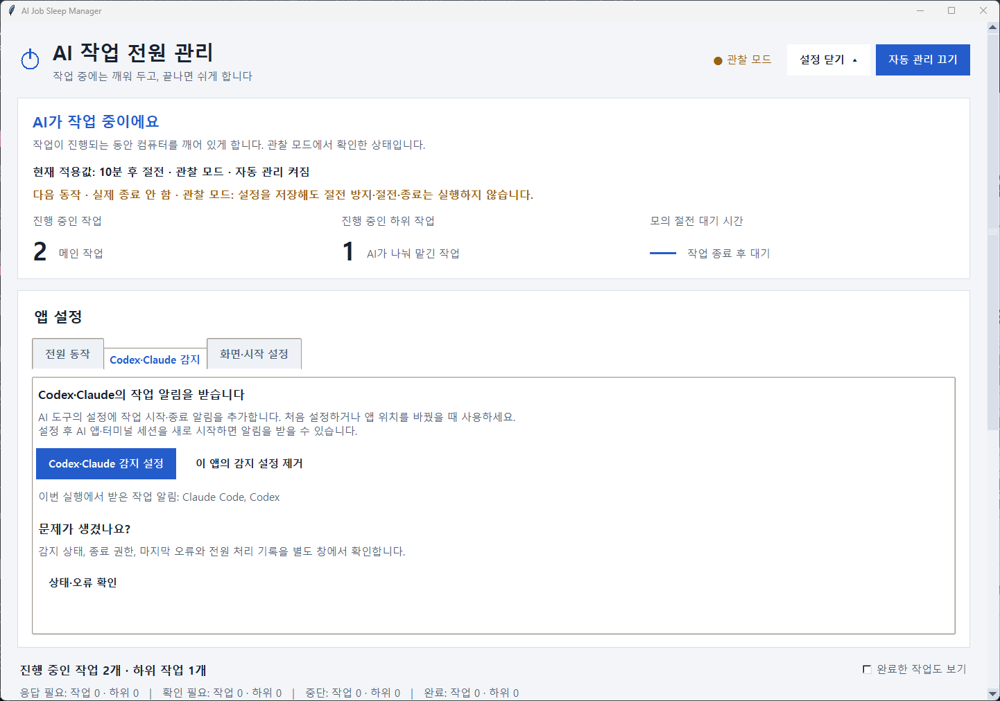

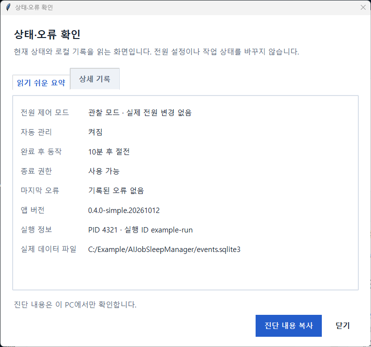

## 接続と設定

1. アプリの設置先を決めます。hook設定に実行パスが入ります。
2. 観察モードで起動し、`설정 열기`（設定を開く）→ `Codex·Claude 감지`（AI検出）を選びます。
3. `Codex·Claude 감지 설정`（AI作業の検出を接続）を押します。既存の設定を保持し、個人用バックアップを作ってから観測用hooksを追加します。
4. AIアプリとターミナルのセッションを再起動し、各ツールが求めるhookの信頼確認を完了します。接続前から実行しているセッションにはイベントの欠落があり得ます。
5. 短い作業を実行し、一覧と`상태·오류 확인`（診断）を確認します。設定ファイルの保存だけでは実際のイベント受信を確認できません。
6. **1〜120分の整数**で待ち時間を指定し、`절전`（スリープ）または`정상 종료`（通常のシャットダウン）を選んで`저장`（設定を保存）を押します。初期値は10分後のスリープです。
7. 設定 → 電源動作で`실제 전원 제어`（実際の電源制御）を選ぶと即時切り替えます。Windowsの権限確認を承認すると、同じデータ位置を使う管理者アプリで開き直します。キャンセル時は既存のモード・停止状態を保持します。
8. 停止中なら`자동 관리 켜기`（自動管理をオン）を選びます。モード変更で停止を自動解除しません。実際の終了権限は別途確認します。
9. 監視中はアプリを開いたまま、または最小化します。他アプリの電源要求はスリープのみを保留し、通常のシャットダウンは妨げません。

`이 앱의 감지 설정 제거`（接続解除）は現在の実行パスと一致する観測用hooksだけを削除し、管理を一時停止します。接続してもAIの承認やデプロイの方針は変わりません。

## 観察モードと実際の電源制御

**設定 → 電源動作 → モードを選択**で即時変更します。追加の適用ボタンはありません。実際の電源制御を保存した通常起動でもWindowsの権限承認を求めます。キャンセルした起動は観察モードになり、保存設定は維持します。[Windows UAC](https://learn.microsoft.com/en-us/windows/win32/api/shellapi/nf-shellapi-shellexecutew)。

| モード | 動作 |
| --- | --- |
| `관찰 모드` — 観察モード | 状態と模擬の待ち時間を表示。実際の電源要求は行わない |
| `실제 전원 제어` — 実際の電源制御 | 観測した作業の実行中に自動スリープを防ぎ、条件を満たしたら設定された電源切り替えを要求 |

実際の制御へ切り替える際は状態を再確認し、設定した待ち時間を最初から数え直します。観察中の時間が過ぎていても、切り替えた瞬間にスリープやシャットダウンはしません。観察モードに戻すと、このアプリのスリープ防止要求を解除します。切り替えに失敗した場合は成功と表示せず、エラーを示します。一時停止や確認が必要な状態は維持します。

**モード変更は保存され、次回の通常起動にも引き継がれます。** 新規導入時は観察モードです。`--dry-run`を明示すると、保存値にかかわらずその起動は観察モードになります。設定画面には現在のモードと次回の通常起動モードを表示します。待ち時間、終了時の動作、一時停止、文字サイズは別途保存されます。

## Windows再起動後の復旧

Windowsの再起動前に観測したAI作業の終了イベントがない場合、次のアプリ起動時に**再起動前に未確認**と表示します。再起動前に実際に作業が終わっていたかは、この記録だけでは分かりません。電源切り替えを保留します。元のCodexまたはClaudeの画面と作業結果を確認し、実際に終了した場合だけ対象を選択して`이 작업이 끝났음을 확인`（終了を手動確認）を押します。確認履歴を保存し、待ち時間を最初から数え直します。

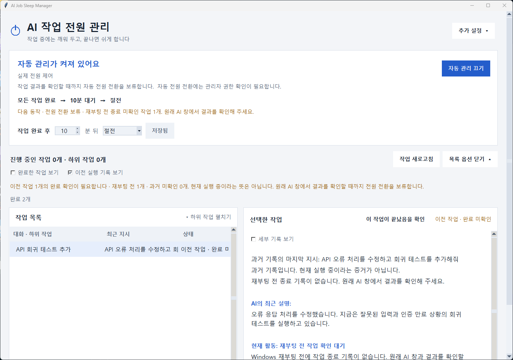

電源設定には任意の**Windowsへのサインイン時に自動起動**があります。サインイン後にアプリを開く機能で、サインイン前にPCのスリープを防いだり、中断したAI作業を再開したりはできません。診断には再起動検出、モード変更、電源要求などの限定的なローカル履歴を残しますが、指示や応答の本文は保存しません。Windows Updateなどのシステム側の再起動をすべて防ぐことはできません。

## スリープとシャットダウンの条件

| 状況 | スリープ選択時 | 通常のシャットダウン選択時 |
| --- | --- | --- |
| まだ作業を観測していない | 待機。カウントダウンなし | 同左 |
| メイン・下位・バックグラウンド作業が実行中 | 自動スリープを防止。予約を取り消す | 同左 |
| 入力・承認待ちだけが残る | 設定時間後のスリープ対象 | 終了予約なし。Windows既存のスリープ設定を許可 |
| 観測した全作業の終了を確認 | 設定時間後にスリープを要求 | 設定時間後に通常のシャットダウンを要求 |
| 再起動前に終了記録がない、または状態不明の作業がある | 元のAIセッションを確認し、利用者が終了を確認するまで保留 | 同左 |
| 待機中に新しい作業やマウス・キー入力 | 取り消し・時間を再計算 | 同左 |
| 状態が不明 | 切り替えを保留し、一時的に復旧を待つ | シャットダウンを要求しない |
| 一時停止・アプリを閉じる | このアプリのスリープ防止を解除 | 同左 |

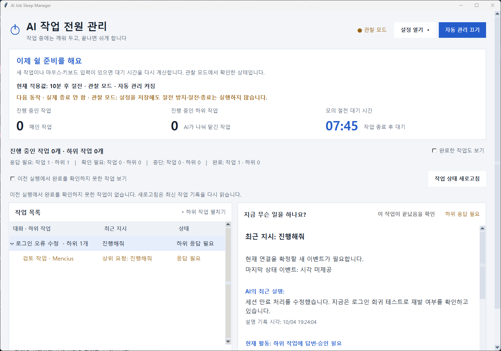

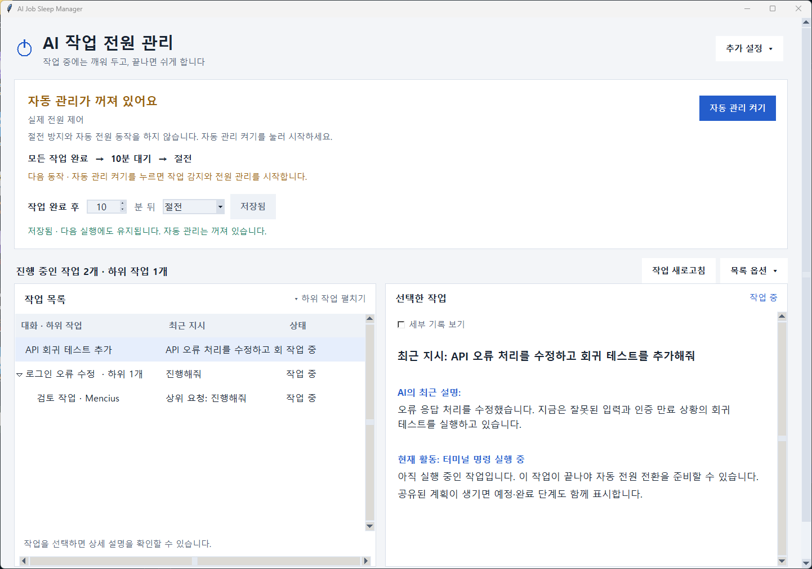

他に実行中の作業がない状態で不明状態が続く場合、初期設定では**30分間**復旧を待ちます。その後は自らスリープや終了を要求せず、このアプリの防止要求を解除してWindowsの設定に任せます。この状態では作業の保護を保証できません。不明な状態を完了に置き換えることはありません。

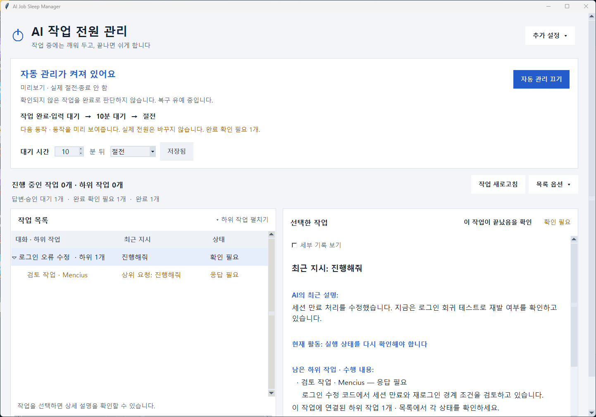

他のアプリの電源要求、権限エラー、電源要求の照会失敗で切り替えを保留する場合があります。スリープは約30秒間隔で再確認します。詳細は診断を参照してください。ディスプレイの消灯は許可されます。

### 通常のシャットダウンは強制終了ではありません

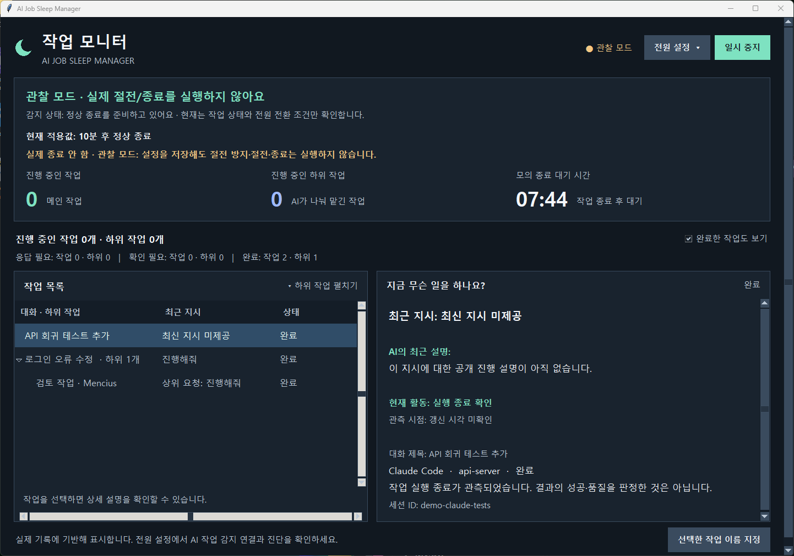

Windowsの`ExitWindowsEx(EWX_POWEROFF)`を使い、`EWX_FORCE`や`EWX_FORCEIFHUNG`は指定しません。プロセスを強制終了したり、すべてのアプリの文書を自動保存したりはしません。保存確認などでユーザー操作が必要になったり、終了が拒否されたりする場合があります。

通常のシャットダウン直前にはAI作業、入力、設定を再確認します。**Chrome・ChatGPT・Claude・ドライバーのスリープ防止要求やpowercfgの照会失敗は通常のシャットダウンを妨げません。** スリープの確認は維持します。管理者かどうかだけではなく、実際の`SeShutdownPrivilege`を有効化して元に戻せるか確認します。

要求前の一時的な照会タイムアウト・SQLiteロックは**30秒間隔、最大10回**再確認します。新しい作業、入力、設定変更があれば待ち時間を最初から計算します。権限・永続的な保存・不明なエラーでは管理を停止します。Windowsへの呼び出し開始後は、権限復元に失敗して送信が不確実でも自動再要求しません。

画面上部に実行モード、管理状態、適用設定、次の動作を表示します。最後の処理状態と一時停止設定をSQLiteに一緒に保存し、再起動後も停止原因を表示します。診断にはバージョン、実行ID、PID、正確なDBパス、保存状態を含めます。更新で停止中の管理を自動的に再開しません。「シャットダウンを要求しました」は要求受け付けを示し、電源が切れたことの確認ではありません。

実機テストは日中に文書を保存し、更新後のアプリで実際の電源制御・1分後の通常シャットダウンを選び、管理を手動で再開してください。短いAI作業の完了後、入力せずに電源が切れることを確認し、次の起動でアプリの`shutdown_requested`とWindows System終了イベントを照合します。エージェントは実機テストを開始していません。

## ローカルデータとプライバシー

| 項目 | 保存先・方針 |
| --- | --- |
| アプリのデータ | `%LOCALAPPDATA%\AIJobSleepManager\events.sqlite3` |
| 保存する情報 | ツール・セッション・ターン・下位作業のID、状態、時刻、設定、文字サイズとテーマ、プロジェクト名、手動の作業名 |
| アプリDBへコピーしない情報 | 指示本文、ソースコード本文、AI応答本文、入力したキーの内容 |
| Claudeのhook設定 | `%USERPROFILE%\.claude\settings.json` |
| Codexのhook設定 | `%USERPROFILE%\.codex\hooks.json` |
| 設定のバックアップ | 元の設定の隣に一意の名前で保存。個人ユーザーのアクセス権を設定 |

公開された指示と応答は各500文字に短縮し、表示のためにメモリだけに保持します。診断やアプリDBにはコピーせず、外部サーバーへ送信しません。非公開のthinkingやツール入出力の原文を活動情報として保持しません。元のAIツールが保存する記録は、そのツール自身が管理します。hooksからAI出力に指示や判断を挿入することはありません。

Codexはローカルのタイトル、プロジェクト、親子関係、明示的な計画も読みます。最新の指示が通常の読み取り範囲にない場合は、直近32MiBまでさかのぼり、現在のターン境界を確認できた場合に限って復元します。表示情報を実行状態の証拠の代わりには使いません。

Codexの状態復元は指示の表示とは別に行います。大きなログの読み取りに空白が生じた場合、直近32MiB以内の明示的なターン開始・終了と入力待ちの要求・応答を確認します。開始イベントの見落としで実行中の作業が「確認が必要」に固定される問題を防ぎます。根拠の欠落・破損・不一致は未確認のままとし、AIの説明やファイル更新だけでは実行・完了を判定しません。

自動接続は既定のユーザーパスが対象です。`CODEX_HOME`または`CLAUDE_CONFIG_DIR`が設定されていると、推測した場所を変更せず接続操作を中止します。カスタムパスへの手動接続手順は未整備です。表示リーダーは指定されたルートを読み取れますが、そこへのhooksの設置を意味するものではありません。

移動する場合は旧位置で接続解除し、AIセッションを再起動して管理アプリを閉じ、新位置で再接続します。2つのEXEと`_internal`を含む**フォルダー全体**を移動してください。アプリを削除してもデータや設定バックアップは残ります。観測機能の削除のためにAI設定ファイル全体を削除する必要はありません。

## トラブルシューティング

| 症状 | 確認すること |
| --- | --- |
| Claudeの作業はあるが内容がない | 一致するローカル記録と最新の指示境界が必要です。診断の`claude_display_status`を確認。下位エージェントやリモートの本文は未対応です。 |
| 作業が表示されない | 接続後にAIセッションを再起動し、hookの信頼確認と新しいイベントを確認。記録ファイルだけではClaudeの実行作業を登録しません。 |
| 一般的な作業名だけ表示される | プロジェクトやセッションIDで確認し、名前を指定。Claudeの自動タイトルは未対応です。 |
| 保存したのに終了しない | 観察モード、一時停止、不明状態、入力・承認待ち、実際の終了権限を確認。スリープ防止要求は通常の終了を妨げません。 |
| `unobserved`が作業として表示される | 最新の実行ファイルに更新してください。`unobserved`は開いているAIプロセスから作られた仮の項目で、実際のセッションではありません。開いているアプリだけでは作業行を作成しません。実際の作業が表示されない場合は**AI作業の検出接続**を確認し、AIセッションを再開してください。 |
| カウントダウンが戻る | 新しい作業やユーザー入力で時間を数え直します。 |
| 管理者ボタンがない | 実際の電源制御を選択するとWindowsの承認・再起動を自動で行います。 |
| 次回起動でも一時停止中 | 停止状態は保存されます。終了要求後も同様です。準備できたら再開します。 |
| 既に実行中と表示される | 既存のウィンドウを使います。モードは電源設定から変更できます。 |
| 移動後に検出できない | 旧パスのhooksを解除し、新しい場所で接続し直します。 |

読み取り専用の診断：

```powershell
python app.py --diagnose
powercfg /a
powercfg /requests
```

電源要求の照会には管理者権限が必要な場合があります。CLIでの観察は最大60秒までです。

```powershell
python app.py --dry-run --observe-seconds 10
```

## 開発と実行ファイルの作成

テストでは電源APIの代替を使い、PCを実際にスリープ・終了させません。

```powershell
python -m unittest discover -s tests -v
python -m compileall -q app.py sleep_manager scripts
```

専用のリンターや静的型チェック設定は現在ありません。

Windowsでビルドします。

```powershell
.\build.ps1
```

`.build-env`を作成し、固定されたビルド依存関係の**PyInstaller 6.22.3**をインストールしてパッケージ化します。依存関係の取得にはネットワークが必要です。

```text
dist/AIJobSleepManager/
├── AIJobSleepManager.exe
├── AIJobSleepHook.exe
└── _internal/
```

作成したフォルダーはPythonの別途インストールなしで実行できます。コード署名はなく、フォルダー一式で使います。

```powershell
.\dist\AIJobSleepManager\AIJobSleepManager.exe --dry-run
```

標準のサンプル画面8枚をWindowsの表示可能なデスクトップで再撮影するには、撮影専用のPillowを使用します。

```powershell
python -m venv .docs-env
.\.docs-env\Scripts\python.exe -m pip install Pillow
.\.docs-env\Scripts\python.exe scripts\capture_screenshots.py
```

一時データと代替の電源入力を使います。撮影中はウィンドウが一時的に前面に表示されます。AI設定や実際の電源状態は変更しません。

### ソース構成

```text
app.py                       # GUI、hook、診断、観察の入口
sleep_manager/
  engine.py                  # 状態と待機時間のルール
  controller.py              # イベント処理と電源切り替え直前の確認
  integrations.py            # hooksの正規化と接続
  codex_logs.py              # Codexの実行状態の観測
  claude_details.py          # 表示専用のClaude記録リーダー
  request_history.py         # Codexの最新指示を範囲制限付きで復元
  activity_view.py           # メモリ上の公開活動
  job_view.py                # タイトル、グループ、表示行
  storage.py                 # ローカル設定とメタデータ
  power.py                   # Windows電源・入力API
  ui.py                      # Tkinter UI
  startup.py                 # ユーザーのサインイン時に自動起動
scripts/capture_screenshots.py
tests/
docs/images/
README.md / README.ko.md / README.ja.md
build.ps1 / AIJobSleepManager.spec / launch.cmd
```

## 検証状況と制限事項

**2026-10-04時点：**

| 確認項目 | 結果 |
| --- | --- |
| 自動テスト | 245件成功。テーマ変更・再起動・保存失敗、回数制限付き再確認・キャンセル・停止理由の復元・重複要求禁止を含む。電源移行は模擬APIを使用 |
| Claudeのローカル内容抽出 | 一致する5セッションから指示と公開応答を確認。実行状態の検証とは別 |
| 構文コンパイル、ビルド、GUI起動・終了 | 成功。GUIとhookをバックアップ後に既存ショートカットのパスへ配置し、分離した観察モードで起動を確認 |
| Windowsの防止要求の作成・設定・解除 | 以前の検証で実APIを確認。スリープ呼び出しは除外 |
| パッケージ化したhookのstdin処理と本文除去 | hook → 分離SQLite → 待機 → 模擬終了要求1回 → 再起動時の停止状態復元を確認 |
| シャットダウン権限の準備確認 | 現在のWindowsセッションでSeShutdownPrivilegeを使用可能。終了APIは未実行 |
| Codexデスクトップの実行中検出 | ローカル記録で確認 |
| Codex CLI 0.139.0 / Claude Code 2.1.259の過去の確認 | イベント受信を確認。モデル・バージョン・利用枠の問題で正常作業の検証に制限あり |
| 4環境すべての完了・入力待ち・再開 | 未完了 |
| 実PCのスリープ・復帰・終了、無人での3夜運用 | 未実施 |

ローカルログの形式はバージョンに依存します。Claude Stopは他のhooksが作業を継続する前の完了候補であり、すべてのバックグラウンド作業の終了を証明しません。長時間動作するサーバー、下位作業、全セッションの検出は保証されません。表示リーダーで実行状態の欠落を補うこともありません。

手動スリープ、ノートPCのふた、バッテリー不足、Modern Standbyには別のOS方針があります。動画再生やダウンロードなど、キー入力を伴わない利用を完全には検出しません。他の電源要求はスリープ時のみ補助的に確認します。イベント受信とWindowsの切り替えを完全に同時にはできません。このアプリを停止しても、他のアプリのスリープ防止は解除されません。
