# AI Job Sleep Manager

[English](README.md) | **한국어** | [日本語](README.ja.md)

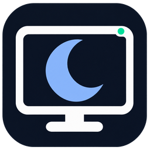

모니터·초승달 아이콘으로 앱 창, Windows 작업 표시줄, 실행 파일, 바탕화면 바로가기를 구분할 수 있습니다. [아이콘 자산과 제작 프롬프트](docs/design/app-icon.md).

**AI가 일하는 동안 PC를 깨어 있게 하고, 작업이 끝나면 설정한 시간 후 절전 또는 정상 종료를 요청하는 Windows 앱입니다.**

Codex와 Claude Code에 긴 개발 작업을 맡긴 채 자리를 비우는 사용자를 위해 만들었습니다. 앱 창이 열려 있는지보다 **실제로 실행 중인 작업이 있는지**를 기준으로 절전을 관리합니다.

> **개발 상태: 초기 구현 / 실사용 검증 진행 중**
> 자동 테스트 전체 통과와 Windows 절전 방지 요청의 설정·해제를 확인했습니다. 실제 작업 완료부터 PC 절전·복귀까지 이어지는 전체 과정과 네 가지 대상 환경의 모든 시나리오는 아직 검증되지 않았습니다. 현재 버전을 검증이 끝난 야간 무인 운영용 제품으로 보지는 않습니다.

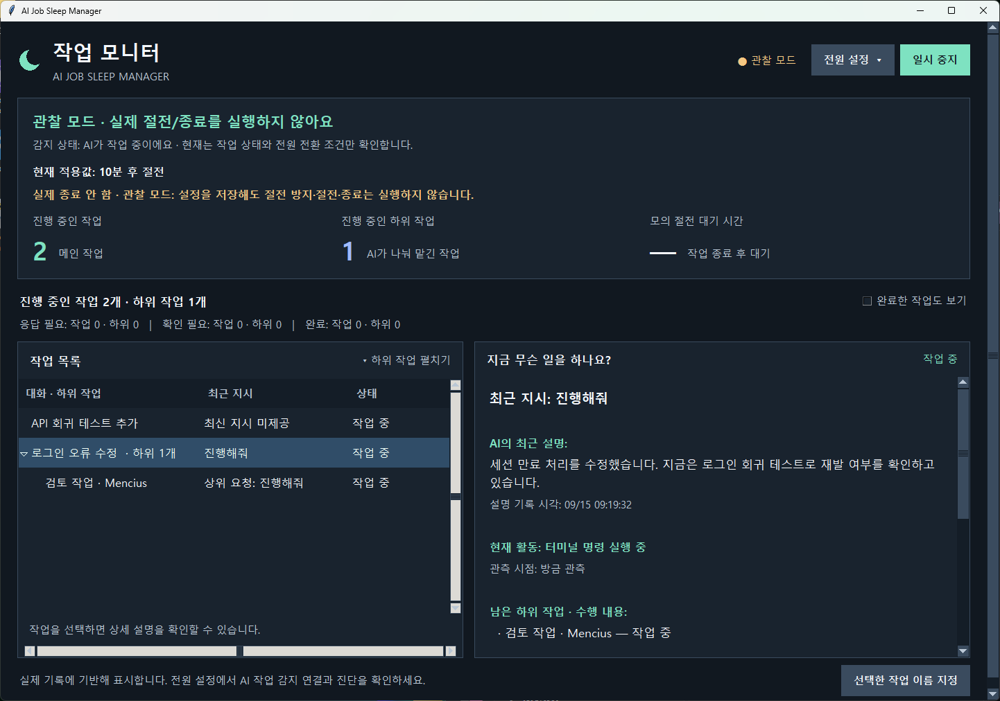

### 첫 화면에서 사용하는 방법

- **대기 시간**에서 대기 분과 절전·정상 종료를 선택하고 **저장**을 누릅니다. 저장만으로 자동 관리가 켜지지는 않습니다.
- 같은 카드의 **자동 관리 켜기 / 끄기**로 시작하거나 중지합니다. 관리 상태, 적용된 동작, 실제 전원 제어인지 미리보기인지 바로 확인할 수 있습니다.
- **추가 설정**에서 실행 모드·AI 감지·테마·자동 실행을 설정합니다. **목록 옵션**으로 완료·이전 작업을 표시하고, **세부 기록 보기**로 시간·연결 근거·세션 번호를 확인합니다.

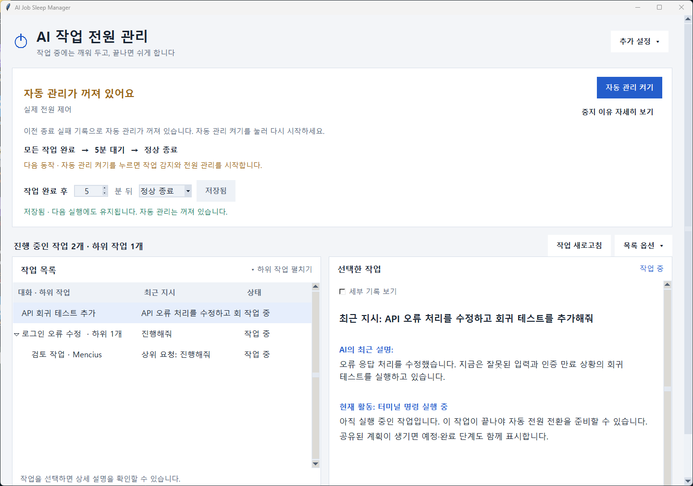


*실제 프로그램 UI를 관찰 모드에서 촬영한 화면입니다. `demo-` 세션은 기능 설명용 예시 데이터이며, 실제 AI 작업 수행이나 절전 성공을 증명하는 화면은 아닙니다. 아래 화면도 같은 방식으로 촬영했습니다.*

## 목차

- [어떤 문제를 해결하나요?](#어떤-문제를-해결하나요)
- [핵심 기능](#핵심-기능)
- [대상 환경과 현재 지원 상태](#대상-환경과-현재-지원-상태)
- [빠른 시작](#빠른-시작)
- [처음 연결하고 사용하는 순서](#처음-연결하고-사용하는-순서)
- [동작 규칙](#동작-규칙)
- [데이터와 설정](#데이터와-설정)
- [문제 해결](#문제-해결)
- [개발 및 실행 파일 빌드](#개발-및-실행-파일-빌드)
- [검증 현황과 알려진 한계](#검증-현황과-알려진-한계)
- [프로젝트 구조](#프로젝트-구조)

## 어떤 문제를 해결하나요?

장시간 AI 작업을 맡길 때 일반적인 전원 설정만으로는 두 가지 문제가 생깁니다.

| 상황 | 겪는 문제 | 이 프로그램의 접근 |
| --- | --- | --- |
| Windows 자동 절전 사용 | 자리를 비우면 개발 작업 도중 PC가 절전될 수 있음 | 실행 중인 작업을 감지한 동안 시스템 자동 절전 방지 |
| AI 앱의 상시 절전 방지 사용 | 작업이 끝나도 앱이 열려 있으면 PC가 계속 켜질 수 있음 | 모든 작업이 완료·입력 대기가 되면 설정 시간 후 절전 요청 |
| 여러 창·터미널에서 동시 작업 | 어느 작업이 아직 실행 중인지 일일이 확인해야 함 | 관측된 Codex·Claude Code 작업 상태를 한 화면에서 집계 |

예를 들어 Codex의 리팩터링과 Claude Code의 테스트를 동시에 실행하면, 한쪽이 끝나도 다른 작업이 실행 중인 동안 보호합니다. 마지막 실행 작업이 끝나면 사용자가 정한 대기 시간을 세기 시작합니다.

이 앱은 AI 작업을 실행하거나 승인하지 않습니다. 작업 지시, 권한 승인, 배포 여부는 기존 AI 도구에서 결정합니다.

## 핵심 기능

### 1. 무엇이 남았는지 알 수 있는 작업 대시보드

작업 목록 위에서 **진행 중인 메인·하위 작업 수**와 답변 대기·확인 필요·완료 개수를 확인합니다. 각 행에는 **AI 아이콘·이름, 작업명, 상태**가 항상 표시됩니다. Codex는 터미널, Claude Code는 별 모양으로 구분하며 색상 외에도 이름으로 확인할 수 있습니다. 내려받은 공식 로고 대신 앱 자체 식별 아이콘을 사용합니다.

오른쪽 상세 상단에는 **AI·프로젝트·메인/하위 구분**과 현재 활동이 표시됩니다. 긴 지시를 과도하게 굵게 표시하지 않으며 같은 작업이 자동 갱신되어도 읽던 스크롤 위치를 유지합니다. UUID뿐인 자동 작업명은 관측된 최신 지시가 있으면 해당 내용으로 표시합니다. 원래 제목과 세션 ID는 **세부 기록 보기**에서 확인합니다.

AI 표시 정보는 `sleep_manager/providers.py` 한 곳에서 관리합니다. 미등록 AI는 공통 아이콘과 해당 ID를 표시하며 다른 AI로 추정하지 않습니다. **표시 등록만으로 새 AI의 작업 감지가 지원되는 것은 아닙니다.** 실제 감지는 별도 연동 어댑터와 검증이 필요합니다.

- 관측된 작업 중 하나라도 실행 중이면 시스템 자동 절전을 방지합니다.
- 지원 이벤트로 확인한 하위 작업도 상태 판단에 반영합니다.
- 입력 대기 작업이 있어도 다른 작업이 실행 중이면 카운트다운을 시작하지 않습니다.
- 화면 꺼짐은 허용합니다. 모니터를 계속 켜 두는 프로그램은 아닙니다.

메인 화면은 **진행 중인 작업 2개 · 하위 작업 1개**인 예시입니다. Mencius는 로그인 오류 수정 작업이 생성한 검토 에이전트이므로 별도의 메인 작업으로 세지 않습니다.

- **내부 승인 검토 제외:** Codex가 도구 실행 승인을 평가하는 내부 guardian 세션은 개발 작업으로 집계하지 않습니다. 원본 메타데이터로 확인하며, 실제 개발 하위 에이전트는 계속 표시·감시합니다.
- **부모 아래에 묶기:** 작업명 왼쪽 화살표를 눌러 하위 작업을 접거나 펼칩니다. 선택한 하위 작업의 상세에는 상위 작업명이 표시됩니다.
- **부모가 먼저 끝나도 표시:** 하위 작업이 남아 있으면 부모 그룹은 “하위 작업 중” 등으로 유지합니다. 하위 작업의 실행·응답 대기·확인 필요 상태를 계속 확인할 수 있습니다.
- **관계가 확인된 작업만 연결:** Codex가 제공한 부모 ID를 사용합니다. 부모가 목록에 없으면 “부모 미확인” 하위 작업으로 표시합니다. 관계 정보가 제공되지 않은 세션은 임의로 묶지 않습니다.

- **남은 작업 중심:** 실행 중·응답 필요·확인 필요 작업을 기본 표시합니다. 완료·연결된 작업은 체크박스로 함께 볼 수 있습니다.
- **첨부 메시지:** 파일 목록과 자동 안내문을 제외하고 실제 요청 문장만 표시합니다. 이미지만 보내면 “이미지 첨부 · 텍스트 지시 없음”으로 표시하며 이미지에서 요청을 추측하지 않습니다.
- **문맥 전달문 구분:** Codex의 내부 승인 평가용 대화 기록 전달문은 사용자 지시로 표시하지 않습니다.
- **큰 로그의 지시 복구:** 최근 로그에 지시가 없으면 최대 32MiB까지 거슬러 읽고 최신 턴의 시작 경계를 확인한 경우에만 지시를 복구합니다. 이전 턴의 지시나 대화 제목으로 채우지 않습니다. 이 복구는 표시 정보에만 적용되며 작업 완료·전원 판단을 변경하지 않습니다.

Codex 상태 복구는 지시 표시와 별도로 수행합니다. 큰 로그에서 읽기 공백이 생기면 최대 32MiB 안의 명시적인 턴 시작·종료 및 입력 대기 요청·응답을 확인합니다. 시작 이벤트를 놓쳐 실행 중인 작업이 **확인 필요**로 고정되는 문제를 방지합니다. 근거가 없거나 손상·불일치하면 미확인을 유지하며, AI 설명이나 최근 파일 갱신만으로 실행·완료를 판단하지 않습니다.
- **요청과 하위 수행 내용 연결:** 부모를 선택하면 남은 하위 작업별 공개 설명을 함께 보여 줍니다. 하위 작업의 직접 지시 본문이 제공되지 않으면 확인된 부모 관계의 **상위 사용자 지시**를 별도로 표시합니다. 상위 요청을 하위 에이전트가 직접 받은 지시로 표현하지 않습니다.
- **최신 지시와 활동:** 오래된 대화 제목과 현재 요청을 분리합니다. `진행해줘`라고 보냈다면 최근 지시에는 그 문장을 표시하고, 현재 활동에는 터미널 명령 실행·파일 수정·도구 응답 수신 등 관측된 활동을 표시합니다.
- **AI의 최근 설명:** 선택 상세에서 AI가 사용자에게 공개한 진행 설명과 기록 시각을 보여 줍니다. 내부 추론이나 명령 출력 원문을 표시하지 않습니다. 최근 도구 요청·응답 흐름도 최대 6개만 메모리에 보관합니다.
- **갱신 상태:** 마지막 활동이 2분 넘게 갱신되지 않으면 “새 활동 기록 대기”로 표시합니다. 완료로 추정하지 않습니다. 새 턴이나 로그 손실 시 이전 지시·활동을 비우며, 최신 지시를 찾지 못하면 미제공으로 안내합니다.
- **작업 이름:** Codex의 로컬 제목 색인과 데이터베이스에서 제목과 프로젝트를 읽습니다. 제목 없는 하위 작업은 제공되는 에이전트 이름·역할로 표시합니다.
- **남은 단계:** Codex가 실제로 공유한 `update_plan`이 있으면 현재 단계와 완료/전체 단계 수, 예정 목록을 보여 줍니다. 계획이 없더라도 관측된 도구 활동과 AI의 공개 진행 설명을 표시합니다. 진행률·완료 시각을 추측하지 않습니다.
- **읽기 편한 글자:** 한글 본문12~13pt, 보조 설명 최소11pt를 기본으로 사용하며 줄 간격과 본문 대비를 높였습니다. **추가 설정 → 화면·시작 → 글자 크기 → 기본 / 크게 / 아주 크게**에서 바꿀 수 있고 다음 실행에도 유지됩니다. 글자 크기 선택은 전원 설정에 영향을 주지 않습니다.
- **밝은 모드·다크 모드:** **추가 설정 → 화면·시작 → 화면 테마**에서 선택합니다. 별도 저장 버튼 없이 즉시 적용하고 다음 실행에도 유지됩니다. 작업 목록·입력 칸·드롭다운·열린 진단 창도 함께 바뀝니다. 작업 상태, 자동 관리 켜짐/중지, 저장 전 전원 설정 입력은 그대로 유지됩니다.
- **창 크기에 맞춘 배치:** 넓은 창은 작업 목록과 상세를 나란히 보여 주고, 좁은 창이나 큰 글자에서는 목록 아래에 상세를 배치합니다. 목록의 가로 스크롤과 열 너비 조절로 긴 이름도 확인할 수 있습니다.
- **읽기 쉬운 대시보드:** 밝은 중립색 또는 짙은 남색 배경, 선명한 글자, 파란 강조색을 사용합니다. 실행 모드·관리 상태·적용값·다음 동작을 한곳에서 확인합니다.
- **목적별 설정:** 전원 동작 / Codex·Claude 감지 / 화면·시작 설정으로 나눴습니다. 버튼 옆 설명과 마우스 도움말로 클릭 후 동작을 확인할 수 있습니다.
- **작은 화면:** 창 높이는 화면에 맞춰 열립니다. 패널 하단이 보이지 않으면 오른쪽 바깥 스크롤바나 화면 여백에서 마우스 휠로 내려가세요.
- **선택 상세:** 목록을 클릭하면 전체 작업명, 상태 설명, 진행/예정/완료 단계, 세션 ID를 확인할 수 있습니다. 긴 상세 내용은 스크롤할 수 있습니다.
- **이름 지정:** 자동 제목을 찾지 못했거나 구분하기 어려우면 선택한 작업에 직접 이름을 붙일 수 있습니다. 빈 이름을 저장하면 원래 표시로 돌아갑니다.

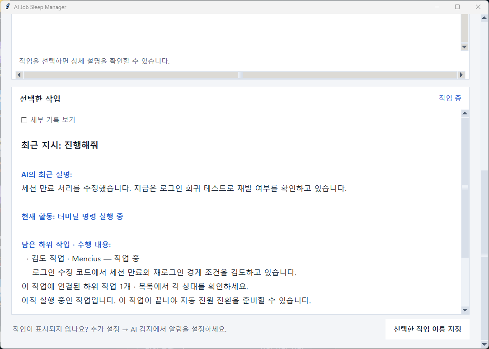

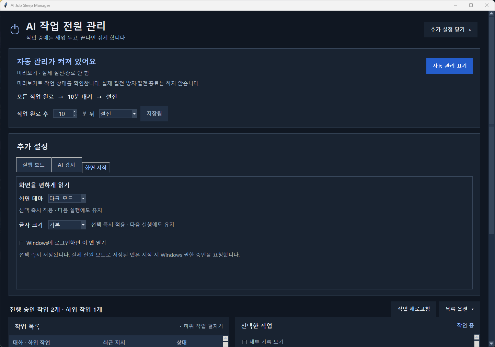

*예시 데이터로 촬영한 실제 앱 화면입니다.*

제목·최신 지시·활동·계획은 표시용입니다. 계획에 모든 단계가 완료로 적혀 있어도 작업 종료 이벤트가 확인될 때까지 실행 중으로 처리합니다. 새 턴이나 로그 읽기 누락이 감지되면 이전 계획을 비웁니다. 원래 AI 앱의 상태와 세부 계획 제공 여부에 따라 표시 가능한 정보가 다릅니다. Claude Code도 연결된 세션의 로컬 기록에서 최신 지시·공개 응답·도구 활동을 표시합니다. Claude의 자동 대화 제목, 세부 계획, 하위 에이전트 기록 내용은 아직 제공하지 않습니다. 프로젝트 폴더명과 사용자 지정 이름은 계속 지원합니다.

### 현재 연결과 과거 미확인 기록 구분

앱을 시작할 때 복원한 미종료 기록 중 현재 연결 근거가 없는 항목은 기본 작업 목록에서 분리합니다. **이전 실행에서 완료를 확인하지 못한 작업 보기**를 켜면 확인할 수 있고, 숨겨진 건수와 전원 전환 보류 안내는 항상 표시됩니다.

**작업 새로고침**은 새 상태 이벤트와 Claude의 로컬 세션 목록을 확인합니다. 세션 ID·PID·Windows 프로세스 생성 시각이 일치해야 연결된 것으로 표시하므로, 오래된 PID 파일이나 재사용된 PID만으로 연결을 인정하지 않습니다. 프로세스가 연결되어 있다는 사실은 작업 실행·완료의 증거가 아닙니다. 상세에는 연결 확인 근거와 마지막 상태 이벤트 시각이 표시됩니다. 새 이벤트가 들어오면 현재 목록으로 돌아옵니다. 현재 실행 중인 항목은 오래되었다는 이유만으로 숨기지 않습니다.

작업 새로고침 자체는 기록을 완료 처리하지 않습니다. 세션 정보 누락·권한 오류는 미확인으로 남습니다. 과거 항목도 종료가 확인되지 않았으면 자동 절전·종료를 계속 보류하며, 화면에서 숨겼다고 전원 전환이 허용되지는 않습니다. 원래 AI 창에서 실행 종료를 확인했다면 해당 항목을 선택해 `이 작업이 끝났음을 확인`으로 기록할 수 있습니다.

### Claude Code: 내 지시와 현재 작업 확인

Claude hooks로 이미 감지된 세션 ID와 `%USERPROFILE%\.claude\projects\*\<session-id>.jsonl`을 연결해 최신 사용자 지시, AI의 최근 공개 응답, 파일 읽기·수정·검색·터미널 실행 등 관측된 활동을 표시합니다. 항목을 선택하면 오른쪽 상세에서 확인할 수 있습니다. 사용자 지정 `CLAUDE_CONFIG_DIR`가 있으면 그 아래의 `projects`를 읽습니다.

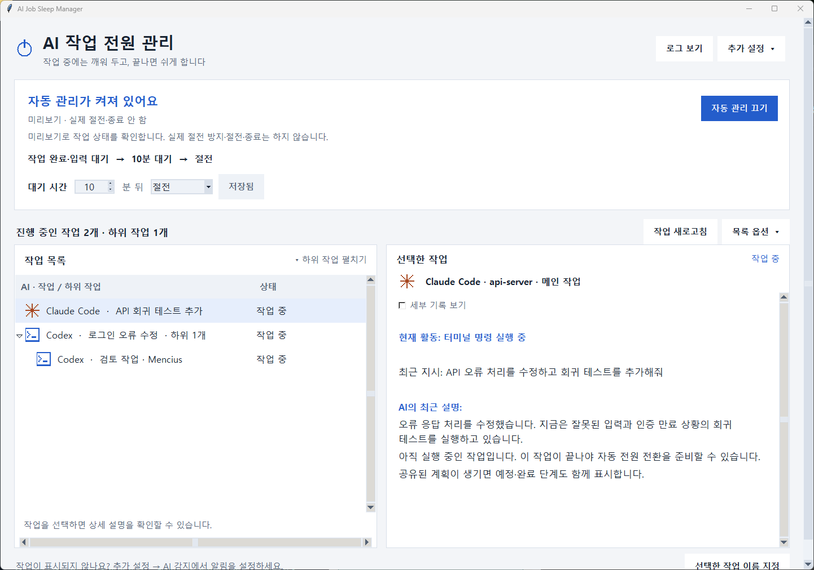

*예시 대화 기록을 실제 수집기와 UI로 읽어 촬영했습니다. 실제 사용자 대화나 PC 전원 동작 결과가 아닙니다. 앱 UI는 현재 한국어이며 README 언어 선택은 UI 언어를 바꾸지 않습니다.*

- 도구 결과, 자동 주입 메시지, 내부 thinking을 사용자 지시로 표시하지 않습니다. 새 지시가 오면 이전 설명을 비웁니다.
- 과거 로그 파일만 있다는 이유로 새 실행 작업을 추가하지 않습니다. 실제 상태는 기존 hooks로 판정합니다.
- 세션에 맞는 기록이 없거나, 최근32MiB 안에 사용자 지시 경계가 없거나, 파일을 읽을 수 없으면 내용을 미제공으로 표시합니다. 새 지시 hook이 먼저 도착하면 이전 요청을 숨기고 기록 갱신을 기다립니다(기록 시각 차이2초 허용).
- Claude의 최신 공개 응답은 완료 응답일 수도 있습니다. 내용만으로 실행 중·완료를 판단하지 않습니다. 자동 제목·세부 계획·하위 에이전트 본문 연결은 이번 범위에 포함되지 않습니다.

### 2. 완료·입력 대기 후 설정 시간에 절전 (기본값)

**저장 여부와 실행 상태를 따로 확인하세요.**

- **현재 적용값:** 설정 패널을 닫아도 상단에 적용 중인 시간과 동작을 표시합니다.
- **미저장:** 입력값을 바꾸면 저장 전까지 사용되는 기존 적용값을 함께 안내합니다.
- **저장 완료:** 버튼 바로 아래에 저장 시각과 저장한 값을 표시합니다. 저장 실패 시 기존 적용값을 유지합니다.
- **실제 종료 안 함:** 관찰 모드(`--dry-run`)에서는 설정을 저장해도 실제 절전 방지·절전·종료를 실행하지 않습니다. 실제 실행의 중지·상태 확인 필요·답변 대기도 별도로 안내합니다.

**추가 설정 → 실행 모드 → 전원 제어 모드**에서 선택하면 바로 전환합니다. 실제 전원 제어를 선택하면 Windows 권한 승인 창이 뜨며, 승인 후 같은 데이터 위치를 사용하는 관리자 앱으로 다시 열립니다. 취소하면 기존 모드·관리 상태를 유지합니다. 기존 관리 중지는 자동 해제되지 않으며 **자동 관리 켜기**를 직접 선택해야 합니다.

실제 전원 제어로 바꾸면 작업 상태를 다시 확인하고 대기 시간을 처음부터 계산합니다. 관찰 모드로 돌아오면 실제 절전 방지 요청을 해제합니다. 일시 중지와 확인 필요 상태는 전환 후에도 유지되므로, 실제 모드에서도 이 상태가 해결되기 전에는 자동 종료하지 않습니다.

모드 전환은 저장되어 **다음 일반 실행에도 유지**됩니다. 새 설치는 관찰 모드로 시작합니다. `--dry-run`을 명시한 실행은 저장값과 관계없이 그 실행에서 관찰 모드로 시작합니다. 설정 패널에 현재 적용 모드와 다음 일반 실행의 시작 모드를 함께 표시합니다.

상단 **설정**을 펼친 뒤 **작업이 끝나면 [숫자] 분 후 [절전 / 정상 종료]**에서 시간을 지정하고 **저장**을 누릅니다. 패널을 열거나 닫기만 하면 설정은 변경되지 않습니다.

| 항목 | 동작 |
| --- | --- |
| 기본 대기 시간 | 10분 |
| 설정 범위 | 1~120분, UI에서 정수 입력 |
| 카운트다운 시작 | 실행 작업이 없고 나머지 상태가 완료·입력 대기 등으로 확인된 경우 |
| 대기 중 새 작업·작업 재개 | 절전 예약 취소, 작업 보호로 전환 |
| 대기 중 마우스·키보드 입력 | 마지막 입력 시점부터 설정 시간 전체를 다시 계산 |
| 대기 중 시간 설정 변경 | 적용 시점부터 새 대기 시간 계산 |

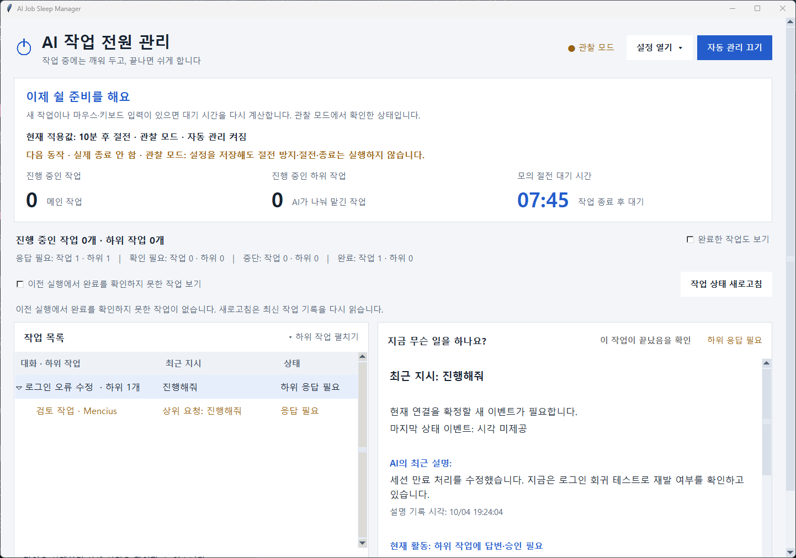

*실행 중인 작업이 0개가 되어 절전 대기 중인 예시입니다. 사람이 답해야 하는 상태로 확인된 작업은 절전 대기 대상에 포함됩니다.*

설정한 시간이 지나기 전 Windows가 자동 절전하지 않도록 카운트다운 중에도 보호합니다. 만료 직전에 새 작업과 사용자 입력을 다시 확인하고, 외부 전원 요청·권한에 문제가 없을 때 절전을 요청합니다.

### 3. 자동 관리 일시 중지·재개

**자동 관리 끄기**를 누르면 예약과 이 앱의 절전 방지 요청을 해제합니다. 이후에는 Windows의 기존 전원 정책을 따릅니다. 다시 **자동 관리 켜기**를 누르면 작업 상태에 따른 관리로 돌아갑니다.

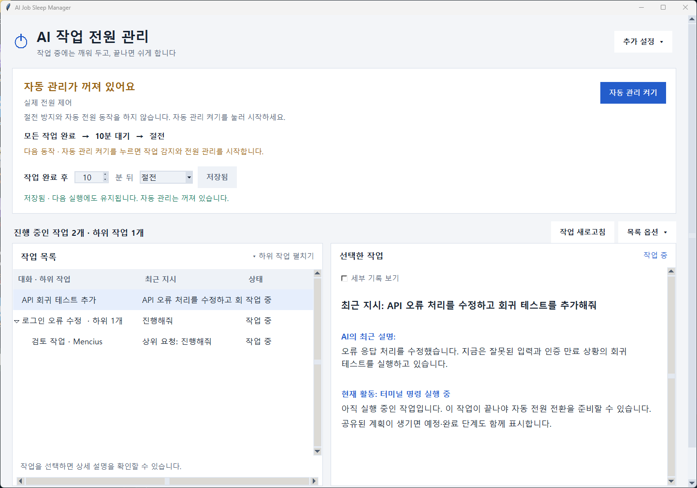

- 일시 중지는 AI 작업 자체를 멈추는 기능이 아닙니다.
- 중지 여부는 저장되므로 앱을 다시 실행해도 유지됩니다.
- 창을 최소화하면 관리를 계속합니다.
- 창을 닫으면 이 앱의 절전 방지를 해제하고 종료합니다.
- 시스템 트레이 상주는 지원하지 않습니다. 전원 설정에서 **Windows 로그인 시 자동 실행**을 선택할 수 있습니다. 로그인 전에는 실행되지 않습니다.

### 4. 감지 불확실성과 절전 보류 표시

연결이 끊기거나 작업 종료를 판단할 증거가 부족하면 **확인 필요** 상태를 표시합니다.

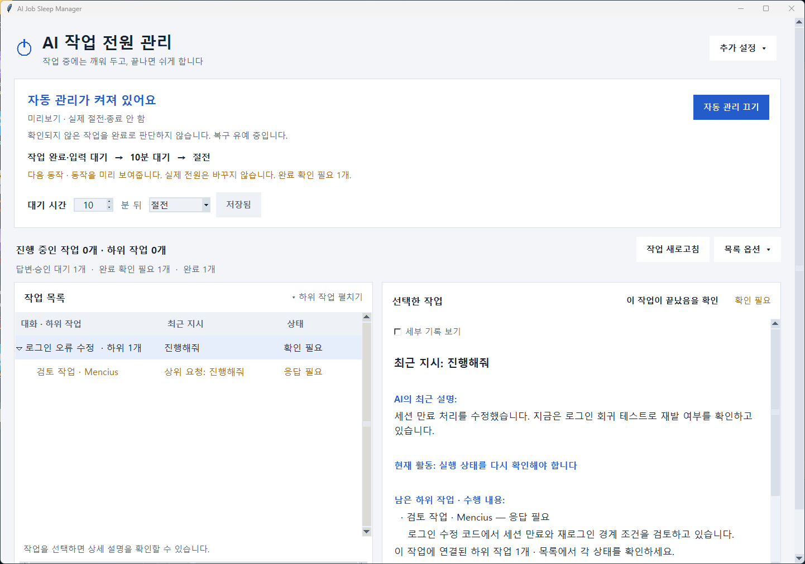

Windows가 다시 시작됐고 그 전에 관측한 AI 작업의 종료 이벤트가 없다면 다음 앱 실행 때 **재부팅 전 미확인**으로 표시합니다. 실제로 재부팅 전에 작업이 끝났는지는 이 기록만으로 알 수 없으며 자동 절전·종료를 계속 보류합니다. 원래 Codex·Claude 창과 결과를 확인한 뒤, 실제로 작업이 끝났을 때만 목록에서 선택해 **이 작업이 끝났음을 확인**을 누르세요. 확인 기록을 저장하고 설정한 대기 시간을 처음부터 계산합니다.

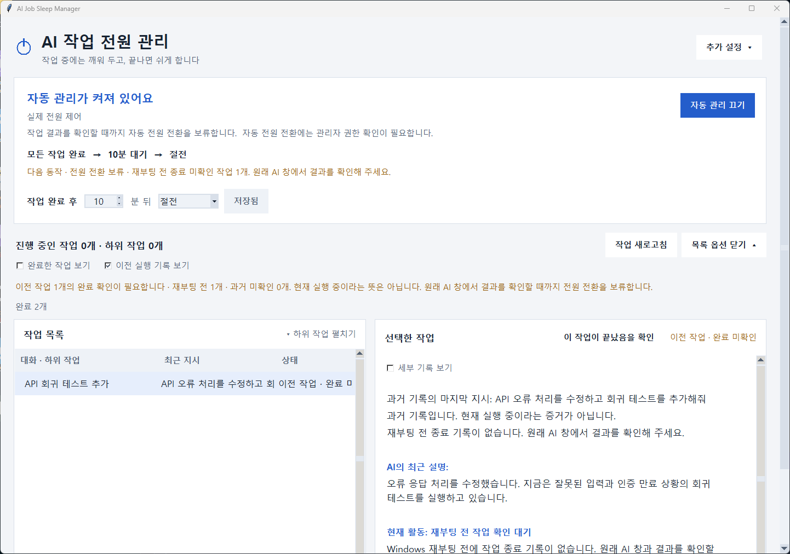

**Windows 로그인 시 자동 실행**은 사용자 로그인 후 앱을 여는 선택 기능입니다. 로그인 전에는 실행되지 않으며, Windows Update 같은 시스템 재시작을 막거나 끊긴 AI 작업을 재개하지는 않습니다. 진단에는 재부팅 감지·모드 변경·전원 요청 등 제한된 로컬 이력을 남기고 지시·응답 본문은 저장하지 않습니다.

다른 실행 작업이 없는 상태에서 불확실성이 계속되면 기본 30분 동안 복구를 기다립니다. 유예가 지나면 자체 절전 요청 없이 이 앱의 보호를 해제하고 Windows 정책을 따릅니다. 따라서 이 상태에서는 진행 중 작업 보호가 보장되지 않으며, Windows가 절전 안 함으로 설정되어 있으면 PC가 계속 켜질 수 있습니다.

다른 앱이 절전을 막거나 전원 요청 목록 조회에 실패하면 절전을 보류하고 약 30초 간격으로 다시 확인합니다. 이유는 **상태·오류 확인**에서 확인할 수 있습니다.

### 5. 버튼이 수행하는 동작

설정을 열면 전원 동작 / Codex·Claude 감지 / 화면·시작 설정 탭을 선택할 수 있습니다.

| 버튼 | 누르면 수행하는 동작 |
| --- | --- |
| **자동 관리 켜기 / 끄기** | AI 작업 중 절전 방지와 완료 후 자동 전원 동작을 시작 / 중지 |
| **Codex·Claude 감지 설정** | 기존 AI 설정을 백업하고 이 앱에 작업 시작·종료를 알리는 설정 추가 |
| **이 앱의 감지 설정 제거** | 이 앱이 추가한 작업 알림 설정만 제거하고 자동 관리 중지 |
| **작업 새로고침** | 최신 작업 기록과 실행 창 정보를 다시 읽음. 작업을 임의로 완료 처리하지 않음 |
| **이전 실행에서 완료를 확인하지 못한 작업 보기** | 완료 근거가 없는 이전 기록 표시. 숨겨도 전원 전환 보류 유지 |
| **상태·오류 확인** | 모드·권한·오류·실제 데이터 위치를 읽기 전용 요약/상세 창에서 확인하고 복사 |
| **로그 보기** (메인 화면 상단) | AI 상태 이벤트와 절전·종료 처리 로그를 바로 표시. 설정과 자동 관리 상태는 바꾸지 않음 |

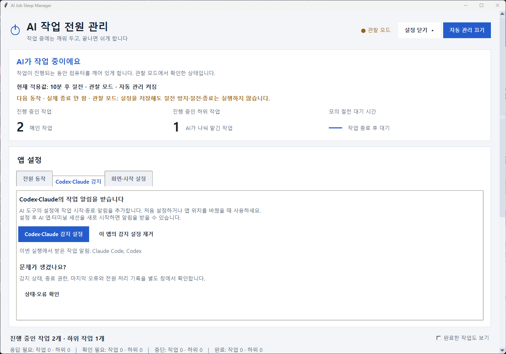

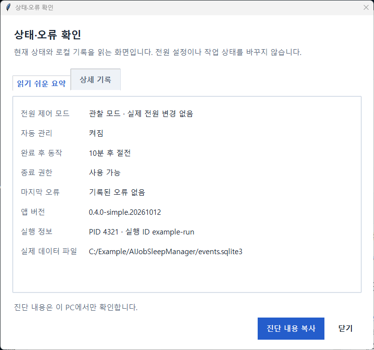

실제 전원 제어 선택 시 [Windows 권한 승인](https://learn.microsoft.com/en-us/windows/win32/api/shellapi/nf-shellapi-shellexecutew) 후 앱이 다시 열립니다. 승인을 취소하면 기존 앱이 유지됩니다. 저장된 실제 모드로 일반 실행할 때도 승인을 요청하며, 취소한 시작은 관찰 모드로 열고 저장값은 보존합니다. 권한 전환으로 자동 관리 중지를 해제하지 않습니다.

감지 설정 저장과 실제 알림 수신은 별개입니다. 설정 후 AI 앱·터미널을 새로 시작하고 짧은 작업의 시작/완료가 나타나는지 확인하세요.

### 6. 작업 완료 후 정상 종료 선택

**설정 → 시간 입력 → 정상 종료 선택 → 설정 저장** 순서로 설정합니다. 기본값은 절전이며 기존 설정은 그대로 절전으로 읽습니다. 선택한 동작은 앱을 다시 실행해도 유지됩니다.

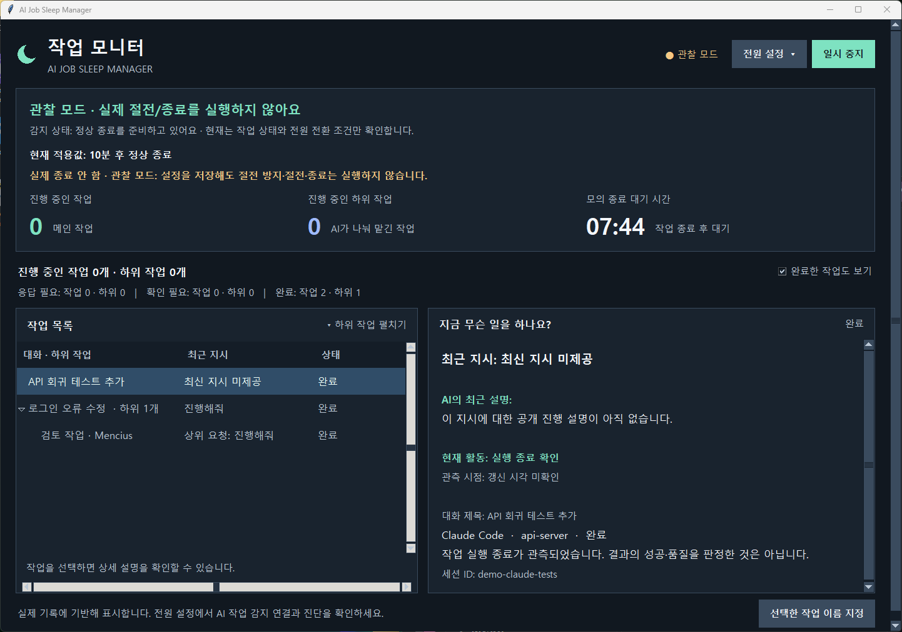

*실제 UI에 예시 완료 이벤트를 넣어 촬영한 화면입니다. 실제 PC를 종료한 결과가 아닙니다.*

| 항목 | 절전 | 정상 종료 |
| --- | --- | --- |
| 실행 중인 AI 작업·하위 작업 | 보호, 예약 취소 | 보호, 예약 취소 |
| 실행·미확인 작업 없이 입력·승인 대기만 남음 | 설정 시간 후 절전 대상 | 응답이 없어도 설정 시간 후 정상 종료 요청 |
| 상태 확인 필요 | 종료로 간주하지 않음 | 종료 예약 금지 |
| 모든 작업 실행 종료가 확인됨 | 설정 시간 후 절전 요청 | 설정 시간 후 Windows에 정상 종료 요청 |
| 대기 중 새 작업·사용자 입력 | 예약 취소·시간 초기화 | 예약 취소·시간 초기화 |
| 요청 후 | 복귀 시 다시 상태 확인 | 자동 관리 중지. 다시 사용하려면 수동 재개 |

**입력 대기 중에도 종료:** 실제 전원 제어·정상 종료·자동 관리가 켜져 있고 실행·미확인 작업 없이 완료·입력 대기만 남으면 설정한 시간 후 응답 없이 정상 종료를 요청합니다. 새 입력 대기는 전체 시간을 다시 세며, 같은 대기 이벤트가 반복돼도 무한히 미루지 않습니다. 답변 후 작업이 재개되거나 마우스·키 입력이 있으면 시간을 다시 계산합니다. 기다리는 작업을 완료 처리하거나 사용자 대신 답변·승인하지 않습니다.

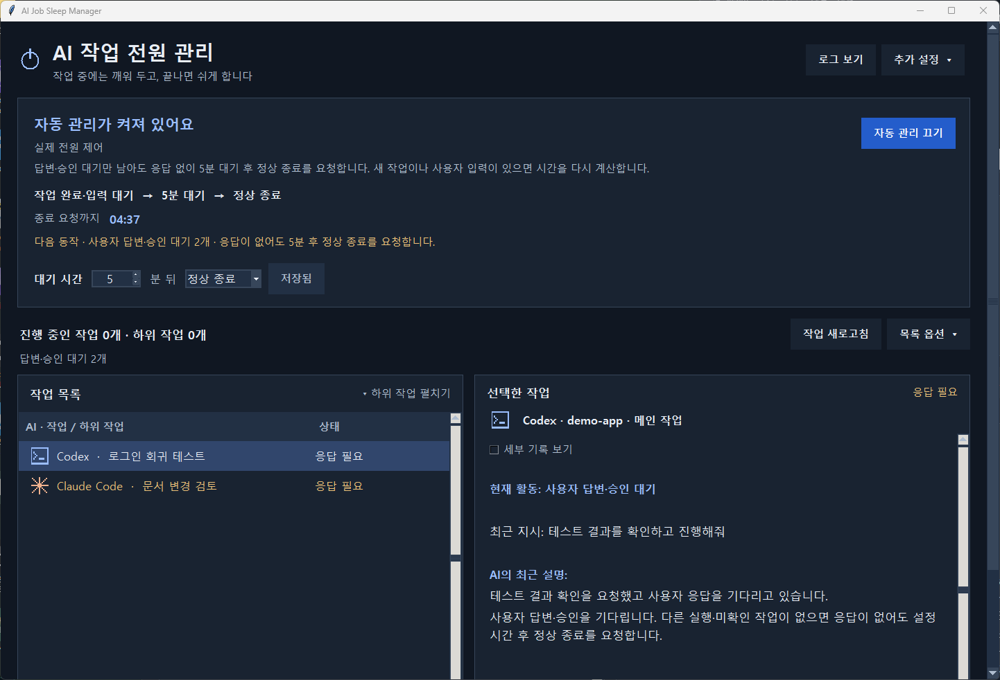

정상 종료는 Windows의 `ExitWindowsEx(EWX_POWEROFF)`를 사용합니다. `EWX_FORCE`, `EWX_FORCEIFHUNG`, 프로세스 강제 종료는 사용하지 않습니다. 앱들은 Windows의 종료 통지를 처리하며, 저장 확인이나 종료 차단이 있으면 사용자 처리가 필요하거나 종료가 취소될 수 있습니다. 자세한 동작은 [Microsoft ExitWindowsEx 문서](https://learn.microsoft.com/en-us/windows/win32/api/winuser/nf-winuser-exitwindowsex)를 참고하세요.

**이 프로그램이 모든 앱의 문서를 자동 저장하거나 데이터 보존을 보장하지는 않습니다.** 다른 앱의 정상 종료 처리와 Windows 정책을 따릅니다. 관리 대상 밖의 서버·다운로드·다른 사용자 세션의 모든 작업이 끝났는지도 보장하지 않습니다.

정상 종료 직전에 AI 작업·입력·설정을 다시 확인합니다. **Chrome·ChatGPT·Claude·드라이버의 절전 방지 요청과 powercfg 조회 실패는 정상 종료를 막지 않습니다.** 절전의 외부 전원 요청 검사는 그대로 유지합니다. 종료 권한은 관리자 여부가 아니라 실제 `SeShutdownPrivilege` 활성화·원상 복구 가능 여부로 검사합니다.

요청 전 일시적인 조회 시간 초과·SQLite 잠금은 **30초 간격으로 최대 10회** 재확인합니다. 새 작업·사용자 입력·설정 변경이 있으면 재시도 주기를 취소하고 대기 시간을 처음부터 계산합니다. 권한·영구 저장·알 수 없는 오류는 자동 관리를 중지합니다. Windows 호출을 시작한 뒤에는 실패나 권한 복원 오류로 전달 여부가 불확실해도 자동 재요청하지 않습니다.

상단에는 실행 모드·자동 관리 상태·현재 적용값·다음 동작을 표시합니다. 마지막 처리 상태와 요청 직전 관리 중지를 SQLite에 함께 저장해 **재실행 후에도 중지 원인이 남습니다.** 진단에는 버전·실행 ID·PID·정확한 DB 경로·저장된 상태가 포함됩니다. 업데이트나 재실행으로 기존 중지를 자동 해제하지 않으며 **자동 관리 켜기**를 직접 눌러야 합니다. `Windows에 정상 종료를 요청했습니다`는 요청 수락을 뜻하며 실제 전원 꺼짐 확인은 아닙니다.

**낮에 실제 종료 시험:** 작업과 문서를 저장한 뒤 갱신된 앱을 다시 열고, 실제 전원 제어·1분 후 정상 종료를 설정한 다음 자동 관리를 직접 재개하세요. 짧은 AI 작업이 완료된 뒤 마우스·키보드 입력 없이 기다려 PC가 꺼지는지 확인합니다. 다시 켠 후 앱의 `shutdown_requested`와 Windows System 종료 기록을 대조합니다. 에이전트는 현재 PC를 즉시 종료하거나 이 실제 시험을 대신 시작하지 않습니다.

현재 자동 테스트와 관찰 모드만 검증했으며, 실제 정상 종료 및 저장 확인 앱에 의한 차단은 아직 실사용 검증하지 않았습니다.

## 대상 환경과 현재 지원 상태

대상은 **Windows 네이티브 환경에서 실행되는 로컬 AI 개발 작업**입니다.

| 대상 환경 | 구현 접근 | 현재 검증 상태 |
| --- | --- | --- |
| Codex 데스크톱 앱 | hooks와 로컬 세션 생애주기 기록 관측 | 실행 중 작업 관측 확인. 전체 완료·대기·재개 흐름 미검증 |
| Claude 데스크톱 앱의 Claude Code | hooks + 일치하는 로컬 기록의 표시 정보 | 실제 데스크톱 전체 흐름 미검증 |
| VS Code 터미널의 Codex CLI | hooks와 로컬 세션 기록 관측 | 별도 CLI 생애주기 관측. 모델·CLI 버전 문제로 정상 완료 미검증 |
| VS Code 터미널의 Claude Code | hooks + 일치하는 로컬 기록의 표시 정보 | 별도 CLI 시작·실패·종료 수신 확인. 정상 완료 및 VS Code 내 전체 흐름 미검증 |

일반 Claude 채팅, Cowork, 브라우저 채팅, 원격 머신, WSL은 현재 자동 연결 대상이 아닙니다. 위 네 환경도 **지원 목표와 어댑터 구현 범위**이며, 모두 검증이 끝났다는 의미가 아닙니다.

## 빠른 시작

### 준비물

- Windows PC와 해당 PC에서 실행되는 Codex 또는 Claude Code.
- 소스 실행: **Python 3.10 이상과 Tkinter**. Windows용 Python 설치 시 Tcl/Tk 지원이 포함되어 있어야 합니다.
- 저장소를 내려받으려면 Git 또는 GitHub의 **Code → Download ZIP** 사용.
- 앱 자체에는 별도 AI API 키나 서버 계정이 필요하지 않습니다. AI 도구의 로그인·사용량은 각 도구에서 관리합니다.

### 소스에서 먼저 관찰 모드로 실행

PowerShell에서 실행합니다.

```powershell
git clone https://github.com/zxcc9867/ai-job-sleep-manager.git
cd ai-job-sleep-manager
python app.py --dry-run
```

저장소가 비공개이면 접근 가능한 GitHub 계정으로 인증해야 합니다. ZIP으로 내려받았다면 압축을 풀고 해당 폴더에서 마지막 명령을 실행합니다.

`--dry-run`은 시작을 관찰 모드로 지정합니다. 관찰 모드에서는 절전 방지·절전·종료를 실행하지 않습니다. 실행 중 사용자가 실제 전원 제어를 선택하면 Windows 권한 승인 후 앱을 다시 열어 전환할 수 있습니다. **Codex·Claude 감지 설정**은 관찰 모드에서도 실제 AI 설정 파일을 수정합니다.

런타임 외부 Python 패키지는 필요하지 않습니다. `python -m tkinter`로 Tkinter 설치 여부를 확인할 수 있습니다.

### 일반 실행

관찰 모드 창을 닫은 뒤 실행합니다.

```powershell
python app.py
```

또는 `launch.cmd`를 더블클릭합니다. `launch.cmd`는 빌드된 실행 파일이 있으면 그것을 실행하고, 없으면 소스 앱을 실행합니다.

**Git 저장소에는 실행 파일과 Python 번들을 포함하지 않습니다.** Python 설치 없이 사용할 폴더형 실행 파일은 [빌드 절차](#개발-및-실행-파일-빌드)로 만들 수 있습니다. 현재 설치 프로그램이나 GitHub Release 다운로드는 제공하지 않습니다.

## 처음 연결하고 사용하는 순서

1. **설치 위치를 먼저 정합니다.** 연결 설정에는 실행 파일 또는 소스의 경로가 들어갑니다.
2. **관찰 모드로 시작합니다.** 설정 → 전원 동작에서 관찰 모드를 선택합니다. 동일 데이터 폴더를 사용하는 앱은 중복 실행되지 않습니다.
3. 상단 **설정**을 펼친 뒤 **Codex·Claude 감지 설정**을 누릅니다. 두 도구의 기본 사용자 설정에 관측용 hooks를 추가하며 기존 설정은 보존합니다.
4. **Codex·Claude 앱 및 터미널의 AI 세션을 재시작합니다.** 도구가 요구하는 hook 신뢰 검토를 완료합니다. 연결 전부터 실행 중인 세션은 이벤트가 누락될 수 있습니다.
5. **짧은 작업을 실행하고 목록과 진단을 확인합니다.** 작업을 시작했을 때 실행 상태가 나타나는지, 완료나 사용자 입력 대기가 올바르게 반영되는지 확인합니다. 계정 또는 CLI 오류가 있으면 먼저 해당 도구에서 해결합니다.
6. **대기 시간과 완료 후 동작(절전 또는 정상 종료)을 지정하고 설정 저장을 누릅니다.** 최초에는 짧은 시간으로 동작을 확인한 뒤 평소 사용할 값으로 바꿉니다.
7. **실제 전원 제어를 선택합니다.** Windows 권한 승인 후 같은 데이터 위치의 관리자 앱으로 전환합니다. 선택은 저장되어 다음 일반 실행에도 유지됩니다. 권한 승인을 취소하면 기존 실행은 그대로 유지합니다.
8. **자동 관리 상태를 확인합니다.** 꺼져 있다면 상단의 **자동 관리 켜기**를 선택합니다. 모드 변경·설정 저장만으로 기존 중지는 해제되지 않습니다. 상태·오류 확인에서 실제 종료 권한도 확인할 수 있습니다.
9. **기존 상시 절전 방지와 충돌을 확인합니다.** AI 앱 등의 상시 절전 방지가 켜져 있으면 이 앱이 절전을 보류할 수 있습니다. 작업 감지가 확인된 뒤 기존 옵션을 조정하세요.
10. **평소처럼 AI 도구에서 작업합니다.** 관리 앱은 켜 두거나 작업 표시줄로 최소화합니다. 실제 절전·복귀는 직접 확인할 수 있는 상황에서 먼저 검증하세요.

연결과 절전 관리가 시작되어도 기존 AI 작업의 승인 정책이나 배포 설정은 바뀌지 않습니다.

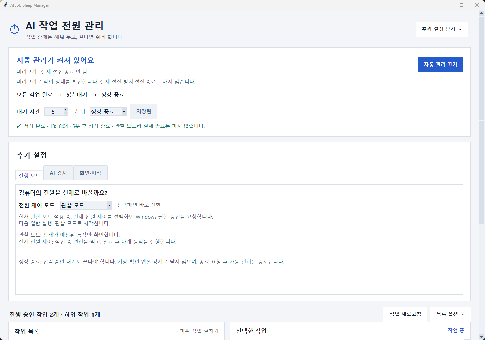

## 동작 규칙

| 현재 상황 | 앱 동작 |
| --- | --- |
| 처음 실행했고 관측된 작업이 없음 | 작업 대기. 자체 카운트다운을 시작하지 않음 |
| 실행 중인 작업이 하나 이상 있음 | 시스템 자동 절전 방지 |
| 모든 작업이 완료·입력 대기이고 상태가 확인됨 | 설정한 시간만큼 대기한 뒤 절전 요청 |
| 카운트다운 중 새 작업·재개 | 예약 취소 및 작업 보호 |
| 카운트다운 중 사용자 입력 | 대기 시간 초기화 |
| 완료 증거가 부족함 | 확인 필요 표시 및 복구 유예 |
| 재부팅 전 작업 종료 기록이 없음 | 종료를 직접 확인할 때까지 자동 절전·종료 보류 |
| 외부 절전 방지·권한 오류 | 절전 보류 및 주기적 재확인 |
| 일시 중지·앱 종료 | 이 앱 소유의 절전 방지 해제 |
| 절전에서 복귀 | 기존 만료 카운트다운을 그대로 실행하지 않고 다시 계산 |

**완료는 작업 이벤트의 종료를 뜻합니다.** 코드 품질, 테스트 성공, 프로젝트 목표 달성 여부를 판정하지 않습니다. 실패·취소도 작업 실행이 끝났다는 증거가 충분한 경우 완료 상태로 정리될 수 있습니다.

권한 요청 이벤트가 발생했다고 무조건 입력 대기로 처리하지는 않습니다. 자동 승인될 요청과 사람이 응답해야 하는 대기를 구분할 증거가 부족하면 확인 필요로 취급합니다.

## 데이터와 설정

| 항목 | 위치 또는 내용 |
| --- | --- |
| 로컬 데이터 | `%LOCALAPPDATA%\AIJobSleepManager\events.sqlite3` |
| 저장하는 정보 | 도구, 세션·턴·하위 작업 식별자, 상태 이벤트, 시각, 관리 설정, 글자 크기와 화면 테마, 프로젝트 폴더명, 사용자가 붙인 작업 이름 |
| 저장하지 않는 정보 | 프롬프트 본문, 소스코드 본문, AI 응답 본문, 키보드 입력 내용 |
| Claude 연결 설정 | `%USERPROFILE%\.claude\settings.json` |
| Codex 연결 설정 | `%USERPROFILE%\.codex\hooks.json` |
| 설정 백업 | 각 설정 파일 옆에 고유 이름으로 생성, 개인 사용자 권한 적용 |

Codex 로컬 세션 기록에서 상태·작업 계획·최신 사용자 지시·공개 진행 설명·도구 요청/응답 식별 정보를 읽고, 로컬 색인/DB에서 제목·프로젝트·부모 관계를 읽습니다. 지시와 공개 설명은 각각 최대 500자로 축약하여 메모리에만 표시하며 앱 DB·진단에 복사하거나 외부 서버로 전송하지 않습니다. 소스코드, 명령/도구 출력 원문, 내부 추론은 활동 정보로 보관하지 않습니다. Claude 내용도 일치하는 로컬 transcript에서 표시용으로만 읽으며 SQLite에 저장하지 않습니다. 상태와 설정 데이터는 서버 없이 로컬 SQLite에 저장합니다. 앱이 추가하는 hooks는 AI 출력에 지시를 삽입하지 않습니다.

자동 연결은 기본 사용자 경로를 대상으로 합니다. `CODEX_HOME` 또는 `CLAUDE_CONFIG_DIR`가 설정되어 있으면 UI가 자동 연결을 중단합니다. 사용자 지정 경로의 수동 연결 절차는 아직 제공하지 않습니다.

### 이동·이 앱의 감지 설정 제거·삭제

1. 현재 위치에서 앱의 **이 앱의 감지 설정 제거**를 누릅니다.
2. AI 앱과 세션을 재시작합니다.
3. 관리 앱을 닫습니다.
4. 프로그램을 옮긴 경우 새 위치에서 **Codex·Claude 감지 설정**을 다시 수행합니다.

폴더형 실행 파일은 `AIJobSleepManager.exe`, `AIJobSleepHook.exe`, `_internal`을 포함한 **폴더 전체**를 옮겨야 합니다. 앱이 생성한 로컬 데이터와 설정 백업은 프로그램 폴더를 삭제해도 남습니다. 필요 없을 때 별도로 정리하세요. 원래 AI 설정 파일 전체를 삭제할 필요는 없습니다.

## 문제 해결

| 증상 | 확인할 내용 |
| --- | --- |
| 제목 대신 “Codex 작업” 또는 “Claude Code 작업”으로 표시됨 | 자동 제목 정보가 없는 세션입니다. 프로젝트와 상세 ID를 확인한 뒤 이름 지정을 사용할 수 있습니다. |
| Claude 작업은 보이지만 내용이 없음 | 연결된 세션과 일치하는 로컬 transcript가 필요합니다. 진단의 claude_display_status와 원래 Claude 창을 확인하세요. 과거 세션·원격 작업·기록 범위 밖의 내용은 추측하지 않습니다. |
| 작업이 목록에 나타나지 않음 | Codex·Claude 감지 설정 후 AI 앱·세션을 다시 시작했는지, hook 신뢰 검토를 했는지, 기본 설정 경로를 사용하는지 확인 |
| 앱을 켜도 절전 방지가 되지 않음 | 관찰 모드인지, 일시 중지 상태인지, 실제 작업 이벤트가 들어오는지 확인 |
| `unobserved`가 작업처럼 표시됨 | 최신 실행 파일로 업데이트하세요. `unobserved`는 열린 AI 프로세스만으로 만든 임시 항목이며 실제 세션이 아닙니다. 이제 열린 앱만으로 작업 행을 만들지 않습니다. 실제 작업이 보이지 않으면 **Codex·Claude 감지 설정**을 확인하고 AI 세션을 새로 시작하세요. |
| 작업이 끝났는데 확인 필요가 남음 | 종료 증거, 하위 작업 상태, 도구 버전 또는 연결 문제 확인. 불명 상태를 강제로 완료로 간주하지 않음 |
| 카운트다운이 계속 처음으로 돌아감 | 새 작업 또는 마우스·키보드 입력이 들어오는지 확인 |
| 절전을 보류했다고 표시됨 | 진단의 `last_error`, 관리자 여부, 다른 앱의 전원 요청 확인 |
| 관리자 권한 버튼이 보이지 않음 | 실제 전원 제어 선택 시 Windows 권한 승인·앱 재실행을 자동으로 진행합니다. 별도 버튼이 필요하지 않습니다. |
| 다시 실행했는데 자동 관리가 멈춰 있음 | 이전에 일시 중지한 설정이 저장됨. 자동 관리 켜기 선택 |
| 이미 실행 중이라는 메시지 | 작업 표시줄의 기존 창을 확인. 설정 → 전원 동작에서 모드 선택 |
| 프로그램을 옮긴 뒤 감지가 안 됨 | 기존 실행 경로의 hooks가 남아 있을 수 있음. 이동 전 이 앱의 감지 설정 제거, 이동 후 다시 연결 필요 |

PowerShell에서 읽기 전용 진단을 실행할 수 있습니다.

```powershell
python app.py --diagnose
```

Windows의 절전 지원 방식과 현재 전원 요청은 다음 명령으로 확인합니다. 전원 요청 조회는 관리자 PowerShell이 필요할 수 있습니다.

```powershell
powercfg /a
powercfg /requests
```

관측만 하는 CLI 실행 예시입니다. 최대 60초까지 실행되며 `--dry-run`을 함께 사용해야 전원 요청이 발생하지 않습니다.

```powershell
python app.py --dry-run --observe-seconds 10
```

## 개발 및 실행 파일 빌드

### 자동 테스트

프로젝트 루트에서 실행합니다. 테스트는 실제 PC 절전·종료를 수행하지 않습니다.

```powershell
python -m unittest discover -s tests -v
python -m compileall -q app.py sleep_manager scripts
```

상태 정책, 중복·역순 이벤트, 하위 작업, 타이머, SQLite, hooks 설정 보존 및 전원 제어 경계 등을 확인합니다. 별도 린터나 정적 타입 검사 설정은 현재 없습니다.

### Windows 실행 파일 만들기

```powershell
.\build.ps1
```

스크립트는 프로젝트의 `.build-env`에 빌드 환경을 만들고 `requirements-build.txt`의 **PyInstaller 6.22.3**을 설치한 뒤 패키징합니다. 빌드 의존성 다운로드에는 네트워크가 필요합니다.

결과:

```text
dist/AIJobSleepManager/
├── AIJobSleepManager.exe   # GUI 앱
├── AIJobSleepHook.exe      # AI hooks의 stdin을 읽는 보조 프로그램
└── _internal/             # Python과 GUI 런타임 등
```

빌드된 앱은 Python을 별도로 설치하지 않고 실행할 수 있습니다. 실행 파일은 코드 서명되어 있지 않으며, 현재 자동 업데이트·설치 프로그램은 없습니다.

```powershell
.\dist\AIJobSleepManager\AIJobSleepManager.exe --dry-run
```

### 문서 스크린샷 다시 촬영

Windows의 보이는 데스크톱에서 다음을 실행합니다. Pillow는 촬영 도구에만 필요합니다.

```powershell
python -m venv .docs-env
.\.docs-env\Scripts\python.exe -m pip install Pillow
.\.docs-env\Scripts\python.exe scripts\capture_screenshots.py
```

실제 UI와 상태 엔진에 예시 이벤트를 전달해 `docs/images/`의 여덟 화면을 촬영합니다. 임시 데이터 폴더와 대체 전원·로그 입력을 사용하므로 사용자 AI 설정, 실제 작업 기록, 전원 상태를 변경하지 않습니다. 창이 잠시 앞으로 나타납니다.

## 검증 현황과 알려진 한계

검증 기준일: **2026-10-04**. 아래 표는 자동 테스트와 실제 환경 확인 결과를 구분한 기록입니다.

| 검증 항목 | 결과 |
| --- | --- |
| 자동 테스트 | 245개 통과. 테마 전환·재실행 유지·저장 실패, 종료 재확인 제한·취소·중지 원인 복원·중복 요청 금지 포함. 전원 전환은 모의 경계 사용 |
| Claude 표시 수집기 | 신규10개 회귀 테스트, 실제 로컬5개 세션의 지시/공개 응답 추출 확인(전원 완료 검증과 별도) |
| 소스 구문 컴파일 | 통과 |
| PyInstaller 폴더형 빌드 | 통과. GUI·Hook 백업 후 기존 바로가기 경로에 설치 |
| 패키징된 GUI 시작·종료 | 설치된 실행 파일을 격리된 관찰 모드로 확인 |
| 패키징된 Hook의 stdin 수신·무출력·본문 제거 | Hook → 격리 SQLite → 종료 대기 → 모의 요청 1회 → 재실행 중지 복원 확인 |
| 정상 종료 권한 준비 검사 | 현재 Windows 세션의 실제 SeShutdownPrivilege 사용 가능 확인. 종료 호출 없음 |
| Windows 보호 요청 생성·설정·해제·닫기 | 실제 API 확인. 절전 호출 제외 |
| Codex 데스크톱 실행 상태 | 실제 로컬 기록 관측 |
| Codex CLI 0.139.0 | 생애주기 관측. 설정 모델이 최신 CLI를 요구해 정상 작업 검증 미완료 |
| Claude Code 2.1.259 | 시작·실패·종료 hooks 수신. 크레딧 부족으로 정상 작업 검증 미완료 |
| 네 환경의 정상 완료·입력 대기·재개 전체 흐름 | 미완료 |
| 읽기 쉬운 작업 목록·필터·이름 저장·계획 상세 | 실제 Tk UI 및 자동 회귀 테스트 확인 |
| 정상 종료 조건·일회 요청·강제 플래그 금지·권한 복원 | 자동 테스트 통과, OS 호출은 대체 경계 사용 |
| 실제 PC 절전·복귀·정상 종료 / 야간 3회 운영 | 미실시 |

알려진 한계:

- Codex 로컬 로그는 비공식이며 버전에 따라 형식이 바뀔 수 있습니다. Stop hook만으로 완료를 확정하지 않습니다.
- Claude의 Stop은 다른 hook이 작업을 재진행시키기 전의 후보 신호일 수 있습니다. 모든 후속 실행의 최종 상태를 관측하는 것은 아닙니다.
- 장시간 백그라운드 명령, 영구 실행 서버, 누락된 하위 작업과 모든 세션의 완전한 발견은 검증되지 않았습니다.
- 프로세스 이름은 보조 확인에만 사용합니다. 모든 작업을 찾았다는 증거가 아닙니다.
- 절전 직전 다시 확인하더라도 이벤트 수신과 Windows 전환을 완전히 동시에 처리할 수는 없습니다.
- 수동 절전, 노트북 덮개 닫기, 배터리 부족, Modern Standby의 배터리 전원 등은 별도 OS 정책·제약을 따릅니다.
- 영상 재생·다운로드처럼 키보드 입력 없이 PC를 사용하는 모든 상황을 별도로 감지하지 않습니다. 다른 앱의 전원 요청 확인에 의존합니다.
- 앱을 닫거나 관리를 중지해도 다른 프로그램이 보유한 절전 방지 요청은 해제하지 않습니다.

## 프로젝트 구조

```text
app.py                       # GUI·hook·진단·관찰 진입점
sleep_manager/
  engine.py                  # 상태 집계와 타이머 정책
  controller.py              # 이벤트 수신과 절전 직전 재확인
  integrations.py            # hooks 정규화 및 연결 설정
  codex_logs.py              # Codex 로컬 생애주기 관측
  claude_details.py          # 감지된 Claude 세션의 표시 전용 공개 기록
  storage.py                 # 로컬 SQLite 이벤트와 설정
  power.py                   # Windows 전원·입력 API
  activity_view.py           # 메모리에서 최신 지시·공개 설명·도구 활동 추적
  job_view.py                # 표시용 제목·프로젝트 조회와 계획·남은 작업 표현
  ui.py                      # Tkinter UI
  startup.py                 # 사용자 로그인 시 자동 실행
scripts/capture_screenshots.py
  # 예시 데이터로 실제 UI 촬영
tests/                       # 자동 테스트
docs/images/                 # README 화면
build.ps1                    # Windows 패키징
AIJobSleepManager.spec       # PyInstaller 구성
launch.cmd                   # 실행 도우미
```

구조는 `AI 이벤트 → 로컬 큐·로그 관측 → 상태 엔진 → Windows 전원 제어`로 나뉩니다. UI는 상태를 보여 주며 정책은 별도 엔진에서 처리합니다.
