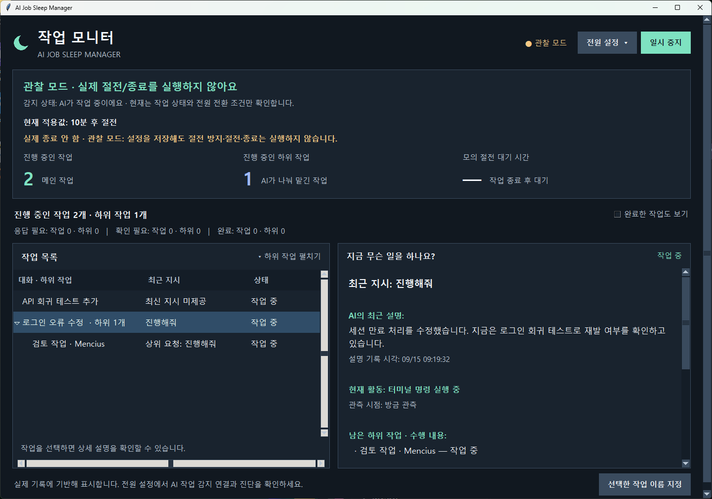
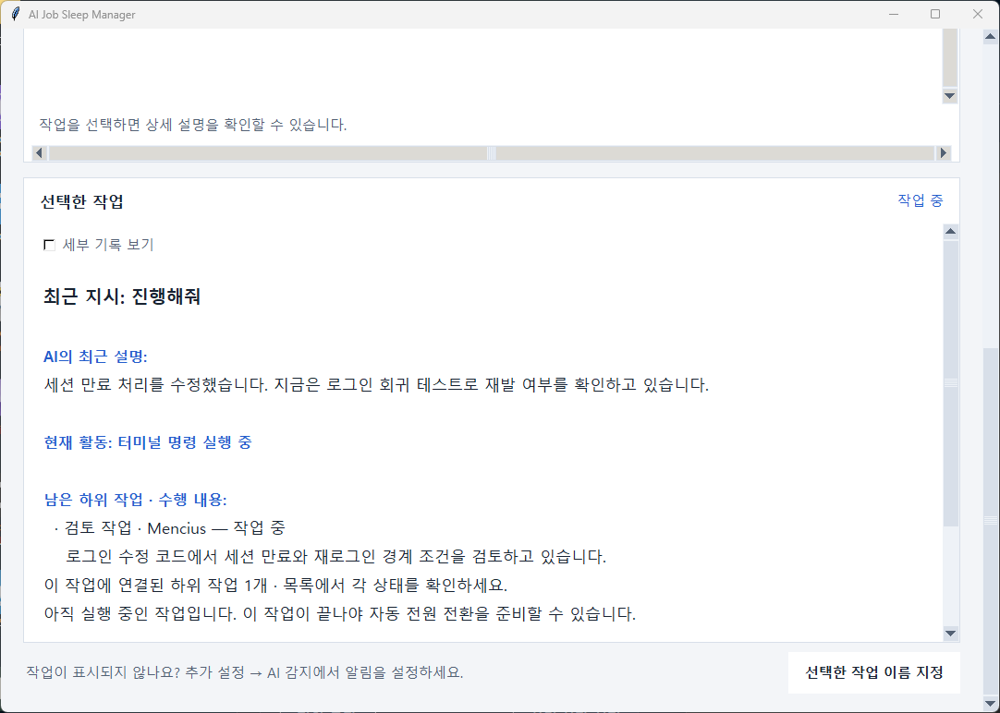
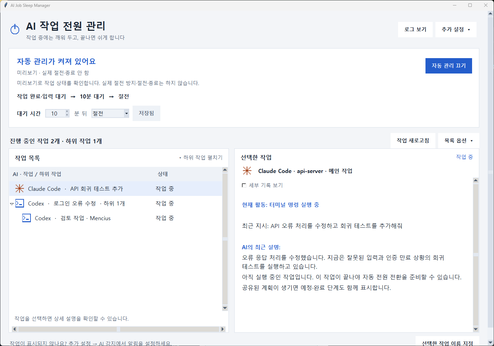
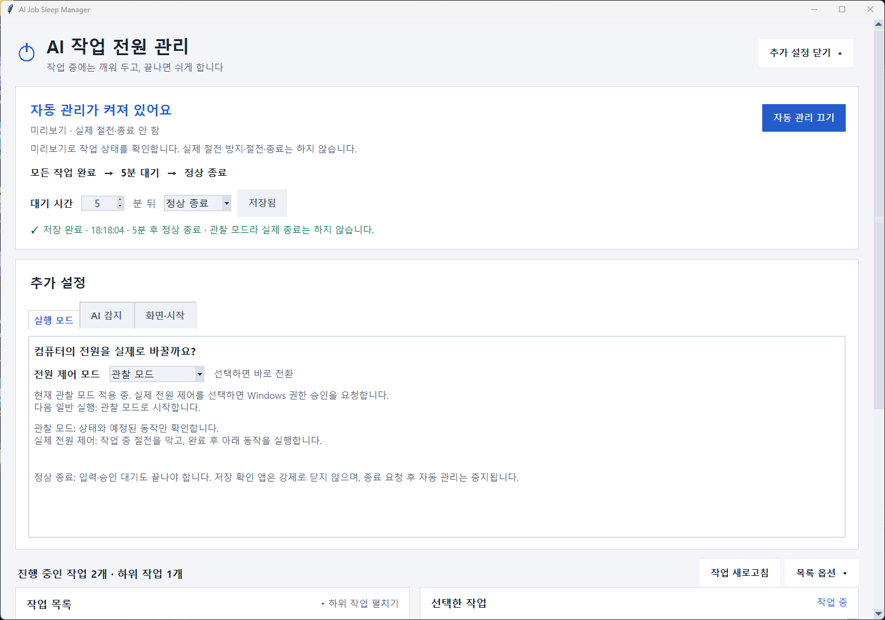
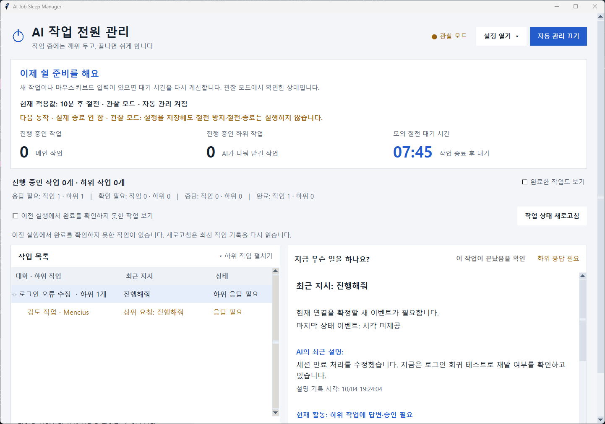
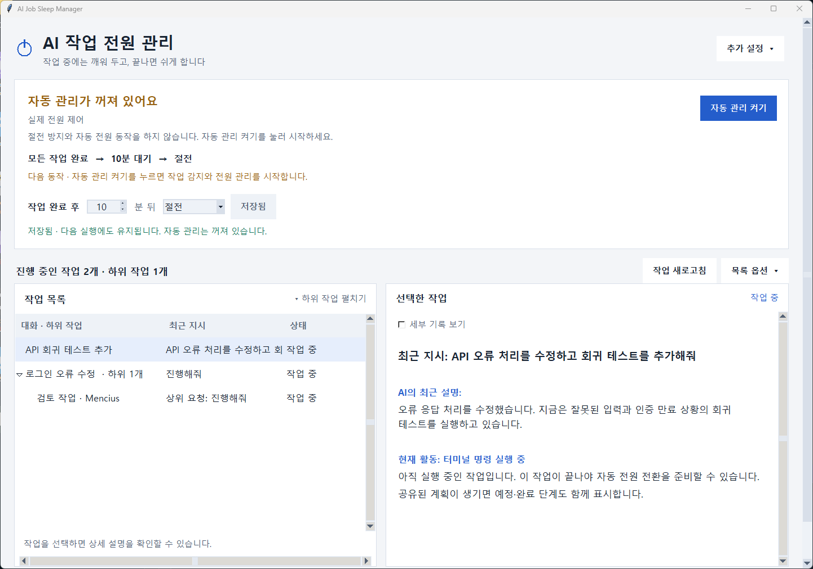
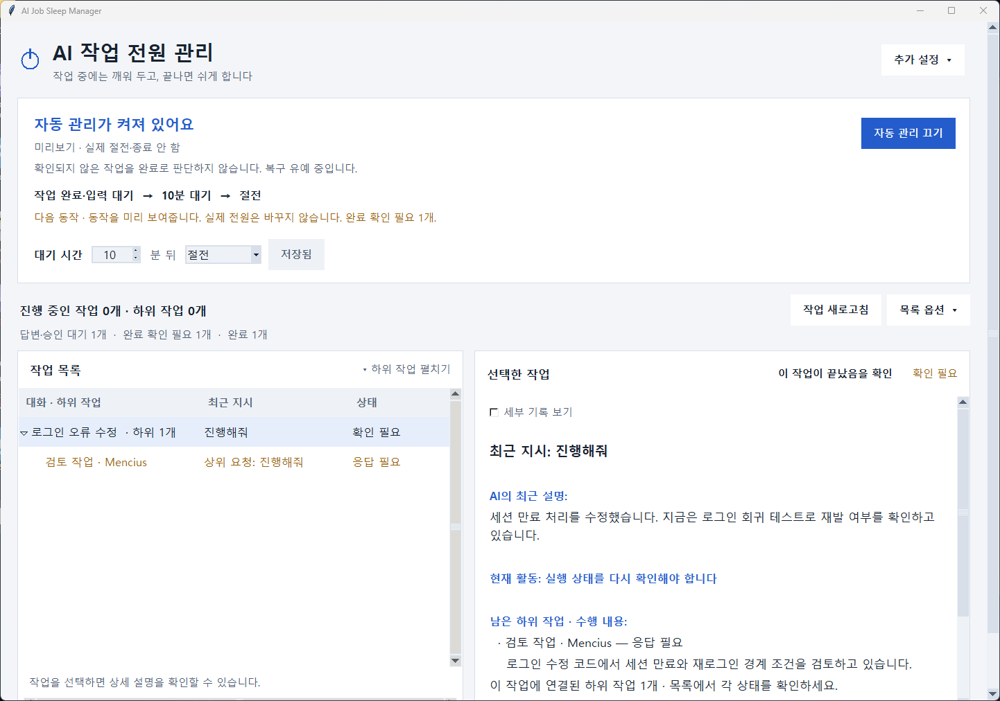
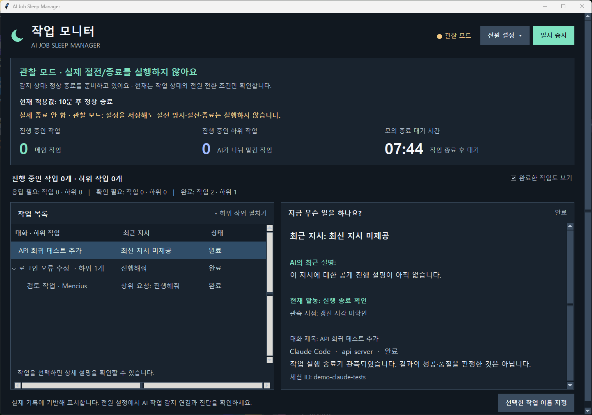

# AI Job Sleep Manager

**English** | [한국어](README.ko.md) | [日本語](README.ja.md)

**Keep your Windows PC awake while AI development jobs run, then request sleep or a normal shutdown after the jobs finish.**

For developers who leave Codex or Claude Code working while they step away. The app watches observed job activity rather than treating an open AI window as an active job.

> **Status: early implementation; real-world validation in progress.** 195 automated tests pass. Building and starting the Windows app have been verified in observation mode. Actual PC sleep/resume/shutdown and complete unattended workflows across all target environments have not been verified.



*Screenshots show the real Korean UI with isolated demonstration data. They do not show private conversations or prove successful PC sleep/shutdown. README language selection does not change the app's UI language.*

## Contents

- [Features](#features)
- [Supported environments](#supported-environments)
- [Quick start](#quick-start)
- [Connect and configure](#connect-and-configure)
- [Observation and actual power control](#observation-and-actual-power-control)
- [Sleep and shutdown rules](#sleep-and-shutdown-rules)
- [Local data and privacy](#local-data-and-privacy)
- [Troubleshooting](#troubleshooting)
- [Development and packaging](#development-and-packaging)
- [Verification and limitations](#verification-and-limitations)

## Features

### Understand which jobs remain

The dashboard separates main jobs from child jobs, with counts for running, awaiting input, unknown and completed states. Expand a parent to see its children; select a row to read the latest instruction and public progress explanation. Completed jobs are hidden by default and can be shown with the checkbox.

- **Instruction → activity:** distinguish the conversation title from your latest instruction, such as “continue,” and the observed work, such as reading a file or running a command.
- **Public updates and timestamps:** show the AI's most recent public response, the last observed activity and a short tool-activity history. Older activity is marked as awaiting new records; silence is not treated as completion.
- **Codex plans:** show steps only when Codex explicitly shares a supported plan. Progress percentages and remaining time are not invented.
- **Child work:** confirmed Codex parent IDs connect related jobs. If a child's direct instruction is unavailable, a known parent's instruction is labeled separately. Remaining child work can be read from the parent detail panel.
- **Clean instructions:** attachment headers and known internal context messages are excluded. Image-only messages receive an attachment label. Confirmed internal Codex guardian approval sessions are excluded from development-job counts.
- **Names:** Codex titles and project names come from local metadata. You can assign a custom name with `이름 지정` (Name). Claude supports the project name and custom names; automatic Claude conversation titles are not implemented.



### Current connections and historical unconfirmed records

Unfinished records restored when the app starts are separated from the current list when there is no current connection evidence. Use **과거 미확인 기록 보기** (Show historical unconfirmed records) to inspect them. The notice shows how many are hidden and explicitly states that they still block automatic power transitions.

**연결 다시 확인** (Recheck connections) reads new lifecycle events and checks Claude's local session registry. A Claude connection is confirmed only when the session ID, PID and exact Windows process creation time match; stale PID files and reused PIDs do not prove a connection. A connected process is not evidence that its job is running or finished. The selected detail shows connection evidence and the last status-event time. New events bring a restored job back into the current list. Active jobs are never hidden just because they are old.

This is a display separation, not deletion or automatic completion. Missing/inaccessible registry data remains unconfirmed. The existing unknown-state power blocker is preserved; hiding an old record does not enable shutdown. The app does not automatically discard unresolved background jobs.

### Claude Code task content

For Claude sessions already observed through hooks, the app matches the session ID to a local file under `.claude/projects/*/<session-id>.jsonl`. It shows the latest user instruction, the latest public assistant text, and observed tool activity such as file reads, edits, searches and terminal commands.



- Tool results, injected metadata and private thinking blocks are not displayed as user instructions. A new instruction clears the previous response.
- Transcript files alone do not create running jobs or establish completion. Hooks remain responsible for Claude lifecycle state.
- Missing, unreadable or unmatched transcripts are left unavailable. Reads are bounded to the most recent 32 MiB per file, with a 64 MiB read budget per refresh. A user-message boundary must be found before responses are shown.
- When a new prompt hook arrives before its transcript entry, the old request is withheld, allowing a two-second timestamp difference between hook and transcript records.
- Claude's latest public text can be a final answer. Its presence does not mean that the job is still running or has finished.
- Claude automatic titles, detailed plans and child-agent transcript content are not implemented. Remote transcripts are not fetched.

### Readable controls and saved-setting feedback

The app uses larger Korean fonts, stronger text contrast, wider rows and additional line spacing. Choose `기본 / 크게 / 아주 크게` (Default / Large / Extra large) under `전원 설정 → 글자 크기` (Power settings → Text size). Text size applies immediately, survives restarts and does not change power settings.

Wide windows show the job list and detail side by side; narrow windows stack them. Scroll the page for controls below the fold, and use the list's horizontal scrollbar or resize columns for long titles.

After `설정 저장` (Save settings), a checkmark, timestamp and saved values appear near the button. Edited values are labeled unsaved, while the header continues to show the applied policy. Failed saves retain the previous policy. Saving a time/action does not change the execution mode.



## Supported environments

The target is **local, native Windows AI development work**.

| Environment | Integration | Verification scope |
| --- | --- | --- |
| Codex desktop | Hooks and local lifecycle logs | Running jobs observed; full completion/wait/resume workflow pending |
| Claude Code in Claude desktop | Claude Code hooks; matching local transcripts for display | Desktop end-to-end workflow pending |
| Codex CLI in a VS Code terminal | Hooks and local lifecycle logs | Separate CLI lifecycle observed; normal completion validation pending |
| Claude Code in a VS Code terminal | Hooks; matching local transcripts for display | Hook reception and local content extraction verified separately; complete VS Code workflow pending |

Ordinary Claude chat, Cowork, browser chat, WSL and remote machines are outside automatic connection support. An implemented adapter does not mean every workflow is verified. The app does not execute AI tasks, approve permissions or deploy your projects.

## Quick start

Requirements: Windows, local Codex or Claude Code, and **Python 3.10+ with Tkinter** for source execution. No external Python package is required at runtime; no AI API key or server account is needed by this app.

In PowerShell:

```powershell
git clone https://github.com/zxcc9867/ai-job-sleep-manager.git
cd ai-job-sleep-manager
python app.py --dry-run
```

Alternatively, download and extract GitHub's **Code → Download ZIP**, then run the last command from that folder. Check Tkinter with `python -m tkinter` if needed.

`--dry-run` starts **observation mode**: no sleep-prevention request, sleep or shutdown is performed. Windows can still sleep according to its own policy. You can explicitly enable actual power control from the app. The Connect button still modifies hook configuration in observation mode.

To start directly with actual power control, close any instance using the same data directory and run:

```powershell
python app.py
```

`launch.cmd` starts the packaged app if available, otherwise the source app. Without `--dry-run`, it starts actual power control. The Git repository does not include executable bundles. Build the folder-based app using the instructions below; there is currently no installer, auto-update system or published executable release download.

## Connect and configure

1. Choose a permanent program location; hook configuration includes that path.
2. Start in observation mode and open `전원 설정` (Power settings).
3. Click `AI 작업 감지 연결` (Connect AI job detection). Existing user settings are preserved and privately backed up before observer hooks are added.
4. Restart the AI apps and terminal sessions, and complete any hook trust review requested by those tools. Already-running sessions can have missing events.
5. Run a short task and check the job list and `진단` (Diagnostics). A saved connection configuration is not proof that events are arriving.
6. Choose a delay of **1–120 whole minutes** and `절전` (Sleep) or `정상 종료` (Normal shutdown), then click `설정 저장` (Save settings). The default delay is 10 minutes and the default action is sleep.
7. Select `실제 전원 제어` (Actual power control) in the execution-mode dropdown and click `모드 전환` (Switch mode). Check the header's applied mode and any blocking reason.
8. If diagnostics report a permission issue, use `관리자 권한으로 열기` (Open as administrator), shown in actual mode when the app is not elevated.
9. Check whether another app's always-awake setting prevents the requested transition. Keep this app open or minimized while monitoring jobs.

`연결 해제` (Disconnect) removes only matching observer hooks for the current launch path and pauses management. Connect does not change AI approval or deployment policies.

## Observation and actual power control

Use **Power settings → Execution mode → select a mode → Switch mode**. Selecting an option alone does not apply it.

| Mode | Behavior |
| --- | --- |
| `관찰 모드` — Observation | Displays jobs and simulated timing; no physical power requests |
| `실제 전원 제어` — Actual power control | Prevents automatic sleep while observed jobs run; requests the configured transition once its conditions are satisfied |

Switching to actual control rechecks activity and starts a fresh full delay. It never immediately sleeps or shuts down just because an observation-mode timer expired. Returning to observation releases this app's physical sleep-prevention request. Failed mode changes report the error rather than claiming success. Pause and unknown-state blockers remain in effect after switching.

**Mode changes apply only to the current run.** On the next launch, command-line options determine the mode. A shortcut containing `--dry-run` starts in observation mode again. The settings panel explains the next start mode for the same launch options. Saved delay, completion action, pause state and text size persist independently.

## Sleep and shutdown rules

| Situation | Sleep selected | Normal shutdown selected |
| --- | --- | --- |
| No jobs have been observed yet | Wait; no countdown | Wait; no countdown |
| At least one main/child/background job is running | Prevent automatic sleep; cancel countdown | Same |
| Jobs await human input/approval; none are running | Eligible for sleep after the delay | Do not schedule shutdown; allow existing Windows sleep policy |
| All observed work has finished | Request sleep after the delay | Request normal shutdown after the delay |
| New activity or mouse/keyboard input during countdown | Cancel/reset the countdown | Same |
| Job state is unknown | Hold transition; temporary recovery protection | Do not request shutdown |
| Pause or close this app | Release this app's prevention request | Same |





If uncertainty persists with no other running work, recovery protection lasts **30 minutes by default**. After that, this app releases its prevention request without requesting sleep or shutdown, leaving Windows policy in control. Continued job protection is not guaranteed in that state. Unknown state is never silently converted to completed.



Other applications' power requests and permission/query failures can block a transition. Sleep retries are approximately 30 seconds apart; inspect Diagnostics. Display blanking is allowed; the app does not keep the monitor lit.

### Normal shutdown is a request, not forced termination



Shutdown uses Windows `ExitWindowsEx(EWX_POWEROFF)` without `EWX_FORCE` or `EWX_FORCEIFHUNG`. It does not kill processes or automatically save every application's documents. Applications can require user action or block shutdown.

The app rechecks jobs, user input and other power requests immediately before transition. Before requesting shutdown, it persists a paused state to avoid repeated shutdown attempts after cancellation or restart. After investigating a failure or cancelled shutdown, resume management manually. “Shutdown requested” means Windows accepted the request, not that the PC has been confirmed powered off.

## Local data and privacy

| Item | Location or policy |
| --- | --- |
| App data | `%LOCALAPPDATA%\AIJobSleepManager\events.sqlite3` |
| Persisted | Provider/session/turn/child IDs, status events, timestamps, settings, text size, project folder names and custom job names |
| Not copied to the app database | Prompt bodies, source-code bodies, AI response bodies or typed keyboard content |
| Claude hook configuration | `%USERPROFILE%\.claude\settings.json` |
| Codex hook configuration | `%USERPROFILE%\.codex\hooks.json` |
| Configuration backups | Unique files beside the original configuration, restricted to the user |

Public instructions and responses are shortened to 500 characters each and held only in memory for display. They are not included in diagnostics or transmitted to an external server. Private thinking and raw tool inputs/outputs are not retained as activity details. The original AI tools manage their own transcript storage. Hook handlers do not inject messages or decisions into AI output.

Codex display metadata also uses local titles/project/parent information and explicit plans. Missing latest Codex instructions can be recovered from up to 32 MiB of recent log data only when a current-turn boundary is proven. Display data never substitutes for lifecycle evidence.

Codex lifecycle recovery is separate: after a large log gap, the observer scans up to 32 MiB for explicit turn start/end and matched input-wait events. This prevents a missed start from leaving an active job at **Needs verification**. Missing, malformed or inconsistent evidence remains unknown; assistant text and recent file activity are not proof of execution or completion.

Automatic connection targets default user paths. If `CODEX_HOME` or `CLAUDE_CONFIG_DIR` is set, the Connect UI stops rather than changing a guessed location; manual custom-path setup is not yet documented. Display readers can use these configured roots, but this does not install hooks there.

Before moving the app: disconnect at the old location, restart AI sessions, close the manager, then reconnect from the new location. Move the **entire** executable folder, including both EXEs and `_internal`. Deleting the program folder does not remove local data or configuration backups. Do not delete entire AI configuration files just to uninstall the observer.

## Troubleshooting

| Symptom | What to check |
| --- | --- |
| Claude job is visible but its content is missing | A matching local transcript and recent user-message boundary are needed. Check `claude_display_status` in Diagnostics. Child-agent details and remote transcripts are not supported. |
| No job appears | Connect, restart AI sessions, complete hook trust review and check new events in Diagnostics. A transcript alone does not register a running Claude job. |
| Generic job title | Use project name/session ID to identify it and assign a custom name. Claude automatic titles are unavailable. |
| Settings saved but no shutdown | Check observation mode, paused management, unknown jobs, input/approval waits and external power requests. Saving does not enable actual control. |
| `unobserved` appears as a job | Update to the current build. `unobserved` was a placeholder created from an open AI process, not a real session. Open apps no longer create job rows; use **Connect AI job detection** and start a new AI session if work is not detected. |
| Countdown keeps resetting | New work or user input resets the full delay. |
| Administrator button missing | It is hidden in observation mode or when already elevated. |
| Management paused after restart | Pause state persists, including after a shutdown request. Resume when ready. |
| Already-running message | Use the existing window; change its mode in Power settings. |
| Detection stopped after moving the app | Remove the old path's hooks and reconnect at the new path. |

Read-only diagnostics:

```powershell
python app.py --diagnose
powercfg /a
powercfg /requests
```

Power-request inspection may require administrator permissions. A bounded CLI observation run (maximum 60 seconds):

```powershell
python app.py --dry-run --observe-seconds 10
```

## Development and packaging

Tests use substitute power boundaries and do not put the PC to sleep or shut it down:

```powershell
python -m unittest discover -s tests -v
python -m compileall -q app.py sleep_manager scripts
```

There is currently no separate linter or static type-check configuration.

Build on Windows:

```powershell
.\build.ps1
```

This creates `.build-env`, installs the pinned **PyInstaller 6.22.3** build dependency, and packages the app. Dependency downloads require network access.

```text
dist/AIJobSleepManager/
├── AIJobSleepManager.exe
├── AIJobSleepHook.exe
└── _internal/
```

The resulting folder runs without a separate Python installation. It is unsigned and must be kept together.

```powershell
.\dist\AIJobSleepManager\AIJobSleepManager.exe --dry-run
```

To regenerate the eight demonstration screenshots on a visible Windows desktop (Pillow is needed only for capture):

```powershell
python -m venv .docs-env
.\.docs-env\Scripts\python.exe -m pip install Pillow
.\.docs-env\Scripts\python.exe scripts\capture_screenshots.py
```

Capture uses temporary data and substitute power inputs; windows briefly come to the foreground. It does not alter AI settings or perform power transitions.

### Source layout

```text
app.py                       # GUI, hook, diagnostics and observation entry point
sleep_manager/
  engine.py                  # Job state and timing policy
  controller.py              # Event ingestion and pre-transition checks
  integrations.py            # Hook normalization and installation
  codex_logs.py              # Codex lifecycle observation
  claude_details.py          # Display-only Claude transcript reader
  request_history.py         # Bounded latest Codex instruction recovery
  activity_view.py            # Ephemeral public activity
  job_view.py                # Titles, groups and display rows
  storage.py                 # Local metadata/settings database
  power.py                   # Windows power and input boundaries
  ui.py                      # Tkinter interface
scripts/capture_screenshots.py
tests/
docs/images/
README.md / README.ko.md / README.ja.md
build.ps1 / AIJobSleepManager.spec / launch.cmd
```

## Verification and limitations

As of **2026-09-21**:

| Check | Result |
| --- | --- |
| Automated tests | 195 pass, including 10 Claude display regressions |
| Claude local content extraction | Instructions and public responses extracted from 5 locally matched sessions; separate from lifecycle verification |
| Source compilation, packaging and GUI smoke test | Verified in observation mode |
| Windows prevention request create/set/clear/close | Previously verified with real APIs; sleep call excluded |
| Packaged hook stdin handling and body removal | Previously verified |
| Codex desktop running-state observation | Verified from local records |
| Codex CLI 0.139.0 / Claude Code 2.1.259 historical checks | Lifecycle reception observed; normal-work validation was limited by model/version or account-credit issues |
| All four environments: finish, wait, resume | Incomplete |
| Actual PC sleep/resume/shutdown and three unattended nights | Not tested |

Log formats are version-dependent. Claude Stop is a completion candidate before other hooks can continue work; it is not proof that every background activity is finished. Not all long-running servers, child jobs or sessions are guaranteed to be discoverable. Display readers cannot fill those lifecycle gaps.

Manual sleep, closing a laptop lid, low battery and Modern Standby have separate OS policies. Passive use such as video playback or downloads is not fully detected; other power requests are used as a safeguard. Event arrival and Windows transition cannot be perfectly atomic. Pausing or closing this app does not release requests owned by other applications.
